# İçten Yanmalı Motorlarda Atık Isı Geri Kazanım Yöntemleri: Literatür Taraması, Tasarım Verilerinin Derlenmesi ve Mühendislik Değerlendirmesi

**Rapor türü:** Akademik araştırma ve tasarım raporu
**Tarih:** Kasım 2026
**Kaynak sayısı:** 52, IEEE numaralı atıf sistemiyle verilmiştir. Hakemli dergi makalelerinin DOI kayıtları Crossref üzerinden doğrulanmıştır.
**Ekler:** `hesap/hesaplar.py` (tekrar üretilebilir hesap betiği), `hesap/sonuclar.json` (sayısal çıktılar), `sekiller/` (12 şekil)

---

## İçerik ve kaynak kullanımına ilişkin açıklama

Bu raporda üç tür içerik vardır. Okuyucunun bunları karıştırmaması için her biri ayrı işaretlenmiştir:

| İşaret | Anlamı |
|---|---|
| **[L]** Literatür bulgusu | Sayı, tablo ya da sonuç, adı geçen yayından değiştirilmeden aktarılmıştır. Yayın ve mümkün olan yerlerde orijinal tablo veya şekil numarası verilmiştir. |
| **[L→Ç]** Literatür verisinden çizilmiş grafik | Bir yayının tablosundaki sayılar bu çalışmada grafiğe dönüştürülmüştür. Sayılar değiştirilmemiştir; grafik orijinal şekil değildir. |
| **[H]** Bu çalışmanın hesabı | Literatürdeki sınır koşulları kullanılarak bu çalışmada yapılmış hesaplardır. Literatür sonucu gibi sunulmamalıdır. |

**Telif ve lisans.** Elsevier, SAE ve Science yayınlarındaki özgün şekiller (CFD konturları, deney düzeneği fotoğrafları vb.) lisans izni olmadan rapora kopyalanmamıştır. Bu şekillerin yerine aynı bilimsel sonuçlar metin ve tablo olarak aktarılmış, okuyucu orijinal şekle DOI üzerinden yönlendirilmiştir. Bazı makaleler CC BY-NC-ND lisanslıdır: Hatami vd. [1], Su vd. [2], Orr vd. [3] ve Quoilin vd. [4]. Bu makalelerin şekilleri, ticari olmayan amaçla, değiştirilmeden ve atıfla yeniden kullanılabilir. Ancak bu çalışmanın yürütüldüğü ortamdan yayıncı sunucusuna tam metin erişimi engellendiği için bu şekiller indirilip rapora eklenemedi. Eklenmesi önerilen şekillerin listesi Ek A'dadır. Raporda numara verilen orijinal şekil ve tablolar yalnızca tam metni okunabilen yayınlardan alınmıştır: Mavridou vd. [5], Lion vd. [6] ve Pasini vd. [7].

---

## ÖZET

**Amaç.** İçten yanmalı motorlarda (İYM) yakıt enerjisinin büyük bölümü egzoz gazı ve soğutma sistemi üzerinden çevreye atılır. Bu çalışmanın amacı, bu atık ısıyı geri kazanan teknolojileri hakemli literatür üzerinden karşılaştırmak, yayınlanmış tasarım verilerini ve sonuçlarını derlemek ve bu verilere dayanarak bir mühendislik değerlendirmesi yapmaktır. İncelenen teknolojiler şunlardır: Rankine çevrimi (organik Rankine çevrimi, ORC, ve su-buhar çevrimi), termoelektrik jeneratörler (TEG), mekanik/elektrik turbo-kompaund ve egzoz ısı değiştiricileri.

**Kapsam ve yöntem.** 2006–2024 arasında yayımlanmış 52 kaynak incelenmiştir: dergi makaleleri, SAE teknik bildirileri ve bir temel kitap. Bibliyografik bilgiler Crossref ve OpenAlex kayıtlarıyla doğrulanmıştır. Sayısal bulgular yayınların özetlerinden ve açık erişimli tam metinlerinden alınmıştır. Tasarım değerlendirmesi için Mavridou vd. [5] seçilmiştir; bu çalışmanın motor çalışma matrisi, ısı değiştirici tasarım verisi ve sonuç tabloları eksiksiz olarak erişilebilir durumdadır. Bu verilerle bu çalışmada bağımsız hesaplar yapılmıştır: LMTD–UA kontrolü, dört farklı akışkanla Rankine/ORC enerji ve ekserji analizi, TEG verim sınırı ve güç türbini kestirimi.

**Temel bulgular.**
1. **[L]** Ağır vasıta dizel motorlarında yakıt enerjisinin en fazla %40–45'i krank miline aktarılır [6]. Egzozla atılan pay %30–40 mertebesindedir [5], [8]. 362 kW'lık bir kamyon motorunda egzozdan geri kazanılabilir ısı, %25 yükte 33.9 kW, %100 yük/1300 rpm'de 136.4 kW'dır [5].
2. **[L]** Deneysel ORC/Rankine sistemlerinin yakıt tasarrufu %3–6 aralığındadır [6], [9]. Simülasyonlar daha yüksek değerler öngörür: ısıl verimde %6.1 artış [10], toplam verimde %12 artış [11]. Xu vd. [12] bu farkı sayısal olarak özetler: simülasyonlarda 0–60 kW, deneylerde 0–14 kW güç geri kazanımı.
3. **[L]** TEG sistemlerinde ölçülen dönüşüm verimi yaklaşık %3'tür (119 W, %2.8 [13]). Araç üstünde ölçülen en yüksek güç 944 W düzeyindedir [14]. Elektrik turbo-kompaund, küçük bir benzinli motorda BSFC'yi en fazla %4, araç çevriminde en fazla %2.7 iyileştirir; sabit çalışma noktasında ise ters basınç nedeniyle kazanç yalnızca ≈%1'dir [7].
4. **[L]** Isı değiştirici tasarımında 40 ppi metal köpüklü plaka tipi, düz borulu gövde-boru tipine göre %73 daha hafiftir ve %68 daha az pompalama gücü gerektirir. Düz kanatlı plaka-kanat tipi ise en düşük basınç kaybını verir (Δp/Δp₀ = 0.014) [5].
5. **[H]** Aynı egzoz kaynağı (503.5 °C, 0.49 kg/s) için ideal bileşen kabulleriyle yapılan analizde net güç şöyle bulunmuştur: R245fa ile 22.7 kW (ηth %10.5), etanol ile 38.6 kW (%17.8), toluen ile 41.0 kW (%18.9), su-buhar ile 42.8 kW (%23.6). Yoğuşma sıcaklığı araç koşullarına daha uygun olan 90 °C'ye çıkarıldığında değerler 12.7–32.8 kW'a düşer. Bu hesaplar literatürdeki deneysel değerlerin (≤14 kW [6], [12]) üst sınırı niteliğindedir.

**Anahtar kelimeler:** atık ısı geri kazanımı, organik Rankine çevrimi, termoelektrik jeneratör, turbo-kompaund, egzoz ısı değiştiricisi, ekserji analizi, dizel motor

---

## 1. GİRİŞ

### 1.1 İYM'lerde enerji kayıpları

İçten yanmalı motorlar, karayolu taşımacılığında, deniz taşımacılığında ve dağıtık enerji üretiminde baskın güç kaynağı olmayı sürdürmektedir [15]–[17]. Yakıtın kimyasal enerjisinin faydalı mil işine dönüşen kısmı sınırlıdır. Lion vd. [6], güncel ağır vasıta dizel motorlarında (HDDE) yakıt enerjisinin "en fazla %40–45" kadarının fren gücüne dönüştüğünü belirtir. Kalan enerji sürtünme, ısı transferi ve egzoz kayıplarıyla çevreye atılır. Hountalas vd. [8] ve Mavridou vd. [5], dizel motorlarda yakıt enerjisinin yaklaşık %30–40'ının egzoz gazıyla atıldığını bildirir. Pandiyarajan vd. [18] egzozla atılan ısıyı yanma ısısının yaklaşık %30'u olarak verir.

Kaybın sıcaklık düzeyi, yani ekserji içeriği, geri kazanım yöntemini belirleyen asıl etkendir. Lion vd. [6] (Bölüm 2.3) atık ısı kaynaklarını iki sınıfa ayırır:

- **Yüksek sıcaklık kaynakları:** egzoz gazı (200–600 °C) ve EGR (200–750 °C).
- **Düşük sıcaklık kaynakları:** soğutma suyu (80–100 °C), yağlama yağı (80–120 °C) ve şarj havası soğutucu (CAC, 50–70 °C).

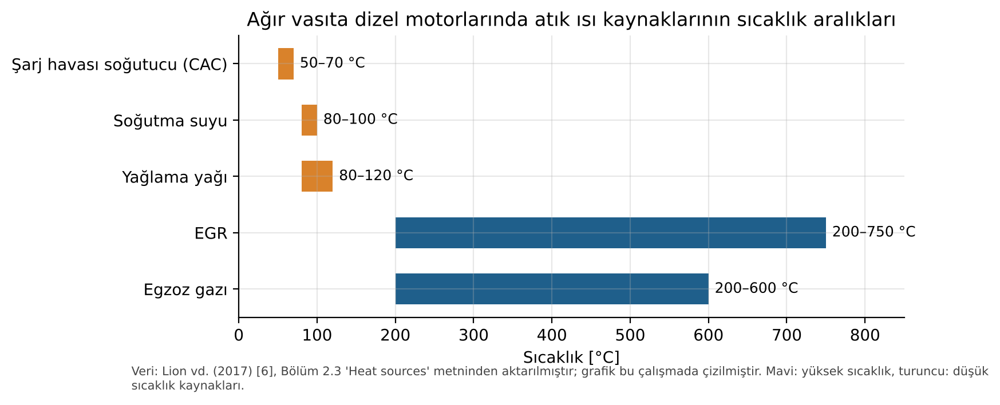

**Şekil 1.** Ağır vasıta dizel motorlarında atık ısı kaynaklarının sıcaklık aralıkları. **[L→Ç]** Veri: Lion vd. (2017) [6], Bölüm 2.3. Grafik bu çalışmada çizilmiştir.

### 1.2 Egzoz ve soğutma suyu ısısının çalışma noktasına bağlılığı

Atık ısının egzoz ile soğutma suyu arasındaki dağılımı motorun çalışma noktasına bağlıdır. Fu vd. [19], benzinli bir motorun tüm çalışma haritası üzerinde enerji ve ekserji dengesi deneyleri yapmıştır **[L]**. Bulgulara göre düşük devir ve düşük yükte atık ısının çoğu soğutma suyundadır. Yüksek devir ve yüksek yükte ise egzoz gazı, hem miktar hem ekserji payı bakımından soğutma suyunu geçer. Yazarlar, atık ısı geri kazanımıyla toplam yakıt verimliliğinin kuramsal olarak yaklaşık %60'a çıkabileceğini öngörür.

Yu vd. [10] dizel motor üzerinde R245fa'lı bir ORC modellemiştir **[L]**. Bu çalışmaya göre yüksek yükten düşük yüke kadar egzoz gazı atık ısısının yaklaşık %75'i, gömlek (ceket) suyu atık ısısının ise yalnızca %9.5'i geri kazanılabilmektedir. Vaja ve Gambarotta [11] da ORC'lerin soğutma suyuyla atılan ısının ancak küçük bir kısmını geri kazanabildiğini vurgular **[L]**. Bu iki sonuç aynı noktaya işaret eder: soğutma suyu enerji bakımından büyük, fakat düşük sıcaklığı nedeniyle ekserji bakımından küçük bir kaynaktır. Endo vd. [20] (Honda) bu sınırı aşmak için motor soğutma devresini yeniden tasarlamıştır **[L]**. Egzoz portunu bir buharlaştırıcıyla değiştirerek 400 °C ve 8 MPa buhar, soğutma devresinden ise 189 °C su elde etmişlerdir.

Mavridou vd. [5] Tablo 1, egzoz kaynağının yük ve devirle nasıl değiştiğini nicel olarak gösterir (Şekil 2) **[L]**. 362 kW'lık motorda ısı değiştiricide aktarılabilen ısı 33.9 kW (%25 yük, 1300 rpm) ile 136.4 kW (%100 yük, 1300 rpm) arasında değişir. Egzoz sıcaklığı 291.0 °C ile 503.5 °C, egzoz debisi 0.205 ile 0.512 kg/s arasındadır. Isı yükündeki bu yaklaşık dört katlık değişim, araç uygulamalarında tasarım noktası dışı çalışmanın neden kritik olduğunu açıklar [5], [12].

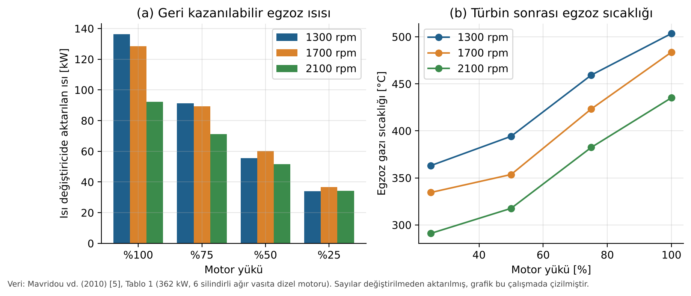

**Şekil 2.** (a) Isı değiştiricide aktarılan egzoz ısısı ve (b) türbin sonrası egzoz sıcaklığı. Veriler motor yükü ve devrine göre verilmiştir. **[L→Ç]** Veri: Mavridou vd. (2010) [5], Tablo 1. Grafik bu çalışmada çizilmiştir.

### 1.3 Geri kazanımın önemi

CO₂ emisyon ve yakıt ekonomisi düzenlemeleri, motor içi iyileştirmelerin sınırına yaklaşıldığı bir dönemde atık ısı geri kazanımını (WHR) önemli bir araç hâline getirmiştir [6], [12]. Teng vd. [21] bir ağır vasıta dizel motorunun atık ısısını termodinamiğin birinci ve ikinci yasasıyla incelemiştir **[L]**. Süperkritik bir ORC ile atık ısının %20'ye kadarının geri kazanılabileceğini ve hibrit sistemin veriminin %50'ye ulaşabileceğini göstermişlerdir. Bu rapor bu potansiyelin ne kadarının pratikte gerçekleştiğini ve hangi tasarım kararlarının sonucu belirlediğini inceler.

---

## 2. ARAŞTIRMA YÖNTEMİ

### 2.1 Tarih aralığı, veri tabanları ve anahtar kelimeler

| Parametre | Değer |
|---|---|
| Tarih aralığı | 2006–2024. Temel kitap [16] 2018 baskısıdır. Kaynakların çoğu 2010–2017 arasında yayımlanmış, sık atıf alan çalışmalardır. |
| Sorgulanan veri tabanları ve dizinler | Crossref REST API (bibliyografik doğrulama ve sorgu), OpenAlex (açık erişim durumu ve lisans), Semantic Scholar Graph API (özet ve açık erişim PDF bağlantısı), RePEc/IDEAS ve EconPapers (Elsevier özetleri), SAE Mobilus (SAE bildiri özetleri), kurumsal arşivler (City Research Online, ARTS Trieste, ARPI Pisa, RiuNet UPV) ve genel web araması |
| Erişilemeyen kaynaklar | ScienceDirect, MDPI ve Europe PMC tam metinleri bu çalışmanın yürütüldüğü ortamın ağ politikası nedeniyle indirilemedi (HTTP 403). Scopus ve Web of Science abonelik gerektirdiğinden doğrudan sorgulanamadı; bu dizinlerde yer alan dergiler Crossref ve OpenAlex üzerinden tarandı. YÖK Ulusal Tez Merkezi'ne programatik erişim sağlanamadı. Türkiye kaynaklı çalışmalar, Türk yazarlı hakemli dergi makaleleriyle temsil edildi [22]–[25]. |
| Anahtar kelimeler (EN) | "waste heat recovery" AND ("internal combustion engine" OR "diesel engine"); "organic Rankine cycle" AND exhaust; "thermoelectric generator" AND (exhaust OR automotive); turbocompound* AND "waste heat"; "exhaust heat exchanger" AND (CFD OR fin OR "metal foam"); exergy AND "engine" AND "waste heat" |
| Anahtar kelimeler (TR) | "atık ısı geri kazanımı", "organik Rankine çevrimi", "termoelektrik jeneratör", "egzoz ısı değiştiricisi", "içten yanmalı motor ekserji" |

### 2.2 Kaynak seçim ölçütleri

1. **Konu:** Yayın doğrudan İYM egzozundan, EGR'den veya soğutma suyundan ısı geri kazanımını incelemelidir. Genel ORC ve TEG derlemeleri yalnızca temel bilgi için kullanılmıştır [4], [26], [27], [28], [29].
2. **Doğrulanabilirlik:** Her makalenin DOI'si Crossref'te çözümlenmiş; yazar, dergi, cilt, sayfa ve yıl bilgisi bu kayıtla karşılaştırılmıştır. DOI'si doğrulanamayan kaynak kullanılmamıştır. Kitap [16] bu kuralın tek istisnasıdır.
3. **Sayısal veri:** Rapora aktarılan her sayısal sonuç ilgili yayının özetinde ya da erişilebilen tam metninde görülmüştür. Yalnızca başlığı veya kapsamı doğrulanabilen yayınlar, sayısal sonuç verilmeden kapsam atfı olarak kullanılmıştır. Bu durum metinde belirtilmiştir.
4. **Yayın türü:** Hakemli dergi makaleleri ve SAE teknik bildirileri kullanılmıştır. Ticari broşür ve haber kaynakları kullanılmamıştır.
5. **Çeşitlilik:** Deneysel ve sayısal çalışmalar; hafif ve ağır vasıta, sabit ve deniz uygulamaları; dört teknoloji ailesi birlikte temsil edilmiştir.

### 2.3 Bu çalışmada yapılan hesapların yöntemi

**[H]** Hesaplar `hesap/hesaplar.py` dosyasında tekrar üretilebilir biçimde yer alır. Akışkan özellikleri CoolProp 8.0 kütüphanesinden alınmıştır. Su için IAPWS-95, organik akışkanlar için Helmholtz enerjisi tabanlı hal denklemleri kullanılır. Ölü hal T₀ = 25 °C ve P₀ = 1.013 bar alınmıştır. Varsayımlar Tablo 6'da toplu olarak verilmiştir.

### 2.4 Çalışmanın akışı

Çalışma altı adımda yürütülmüştür (Şekil 3). İlk üç adım literatürden veri toplamaya, son üç adım bu verilerin bağımsız olarak doğrulanmasına, çevrim analizine ve mühendislik değerlendirmesine ayrılmıştır.

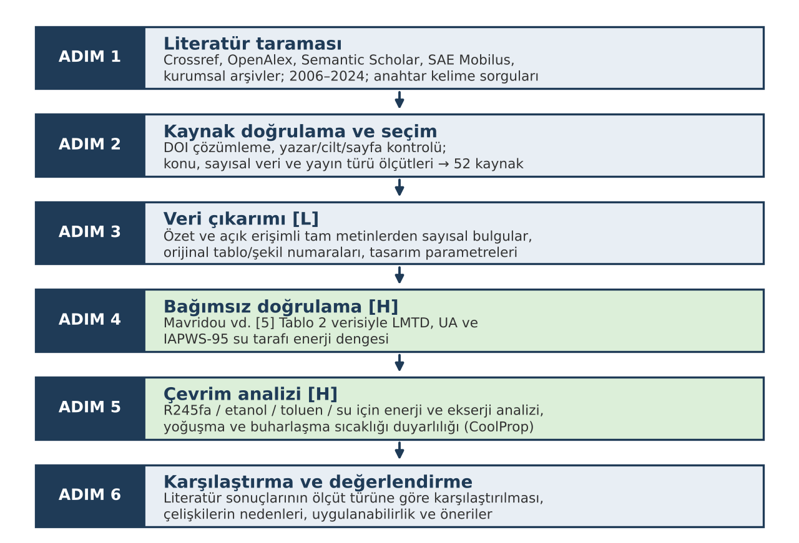

**Şekil 3.** Bu çalışmada izlenen yöntemin akış şeması. Mavi kutular literatürden veri toplama adımlarını, yeşil kutular bu çalışmada yapılan bağımsız hesapları **[H]** gösterir.

---

## 3. LİTERATÜR TARAMASI

### 3.1 Teknolojilere genel bakış

Saidur vd. [15] egzoz ısısı geri kazanım teknolojilerini üç grupta toplar: termoelektrik jeneratörler, Rankine alt çevrimleri ve turbo-kompaund. Sprouse ve Depcik [30] ile Wang vd. [31] İYM'lerde Rankine çevrimi çalışmalarını derlemiştir. Lion vd. [6] ve Xu vd. [12] ağır vasıta uygulamalarına odaklanır. Aghaali ve Ångström [32] turbo-kompaundu, Orr vd. [3] ve Champier [27] TEG'leri, Hatami vd. [33] ise egzoz ısı değiştiricisi tasarımlarını derlemiştir. Shu vd. [17], iki zamanlı gemi motorlarında aynı teknolojilerin daha büyük ölçekte uygulandığını gösterir.

**Tablo 1.** Atık ısı geri kazanım teknolojilerinin karşılaştırması. **[L]** Sayısal değerler köşeli parantezde gösterilen yayınlardan alınmıştır.

| Teknoloji | Çalışma prensibi | Kaynak sıcaklığı | Raporlanan performans | Avantajlar | Dezavantajlar |
|---|---|---|---|---|---|
| Su-buhar Rankine | Egzoz ısısıyla su buharlaştırılır ve genleştiricide iş elde edilir | Egzoz ve EGR, >300 °C | Honda: ηth %28.9 → %32.7 (göreli +%13.2), 100 km/h [20]. Kamyon simülasyonu: %6–10 verim kazancı (%100 yük) [5]. Ek güç %11, bsfc %12 [34]. | Yüksek ısıl verim; ucuz, yanıcı olmayan ve çevre dostu akışkan | Donma riski; düşük hacimsel debi nedeniyle pistonlu genleştirici gerekir [5]; ıslak genleşme |
| ORC | Organik akışkanla düşük ve orta sıcaklıkta Rankine çevrimi | 80–400 °C | Etanol ORC deneyi: yakıt tasarrufu %3–5 [9]. Benzinli motor: güçte en fazla %3.7, genleştirici 1.83 kW [35]. Sabit motor: toplam verimde %12 [11]. | Düşük sıcaklıkta verimli; kuru akışkanla ıslak genleşme olmaz | Akışkanların yanıcılığı ve GWP değeri; maliyet; ağırlık; geçici rejimde kontrol güçlüğü [12] |
| TEG | Seebeck etkisiyle doğrudan elektrik üretimi | 100–600 °C | 40 modül: 119 W, η %2.8, Δp 0.45–1.46 kPa [13]. Araç testi: 944 W [14]. | Hareketli parça yok; sessiz; ölçeklenebilir [3], [28] | Düşük verim; malzeme maliyeti; sıcak yüzey sıcaklığı sınırı [3], [29] |
| Mekanik/elektrik turbo-kompaund | Egzozda ek güç türbini çalıştırılır; güç mekanik ya da elektrik olarak alınır | Türbin girişinde 400–700 °C | Elektrik turbo-kompaund (ETC): BSFC'de en fazla %4, araç çevriminde en fazla %2.7 iyileşme; sabit noktada ≈%1 [7]. | Kompakt, bilinen teknoloji; ek akışkan çevrimi yok [32] | Ters basınç pompalama kaybını artırır; düşük yükte kazanç yok [7] |
| Egzoz ısı değiştiricisi (doğrudan ısı kullanımı veya depolama) | Egzoz ısısı su veya ısı depolama ortamına aktarılır | 150–500 °C | Faz değiştiren malzemeli depolama: yakıt gücünün %10–15'i ısı olarak depolanır [18] | Basit; kojenerasyon için uygun | Elektrik veya mil işi üretmez; kirlenme (fouling) riski |

### 3.2 Rankine çevrimi (ORC ve su-buhar)

#### 3.2.1 Araç üzerindeki uygulamalar

Lion vd. [6] Tablo 3, araç üzerindeki ORC uygulamalarını derler. Tablonun bir kısmı aşağıda aynen aktarılmıştır (Tablo 2). Tablo, genleştirici seçiminin ve ölçeğin ne kadar farklılaştığını gösterir. İzentropik verim Ricardo scroll genleştiricisinde %30, Cummins türbin genleştiricisinde %77'dir. Genleştirici gücü 1.2 kW ile 42 kW arasında değişir.

**Tablo 2.** Araç ORC uygulamalarının özeti. **[L]** Lion vd. (2017) [6], Tablo 3'ten seçilmiş satırlar; "n.a." orijinal tabloda veri olmadığını gösterir.

| Firma | Motor | Uygulama | Motor gücü [kW] | Genleştirici | Akışkan | İzentropik verim [%] | Azami genleştirici gücü [kW] | Devir [rpm] |
|---|---|---|---|---|---|---|---|---|
| Thermo-Electron | Mack 676 dizel | Uzun yol kamyonu | 215 | Türbin | Fluorinol-50 | n.a. | n.a. | 37 000 |
| Cummins | Cummins ISX dizel | Uzun yol kamyonu | n.a. | Türbin | R245fa | 77 | 42 | 50 000–80 000 |
| Honda | 2.0 L benzinli | Hibrit binek araç | n.a. | Eğik plakalı eksenel pistonlu | Su-buhar | n.a. | 2.5 | 3000 |
| BMW | 4 silindirli benzinli | Binek araç | n.a. | Paletli (vane) | Su-buhar/etanol | n.a. | 2 | n.a. |
| Oak Ridge NL | 1.9 L benzinli | Binek araç | 66.7 | Türbin | R245fa | n.a. | 4 | 80 000 |
| Bosch | 12 L dizel | Uzun yol kamyonu | n.a. | Pistonlu/türbin | Su-buhar/etanol | 70ᵃ | 12.3 | 150 000ᵃ |
| Ricardo–Volvo | 12.9 L Volvo D13 | Uzun yol kamyonu | 288 | Pistonlu | Etanol-su karışımı | 70 | 14ᵇ | 1500 |
| Ricardo–Wright Bus | 2.4 L Ford Puma dizel | Dizel-hibrit şehir otobüsü | 140 | Scroll | R245fa | 30ᵇ | 1.2 | n.a. |

ᵃ Türbin genleştirici verisi. ᵇ Ricardo testlerinden.

Aynı derlemede aktarılan diğer sonuçlar **[L]** [6]:

- Behr, BISS simülasyonuyla ESC çevriminde %5 yol yakıt tüketimi iyileşmesi göstermiştir. Euro VI kamyon motorunda pistonlu genleştiricili deneysel bir ORC ile %6'ya kadar ek güç elde etmiştir.
- Cummins, toplam motor veriminde %5–8 potansiyel iyileşme bildirmiştir.
- Ricardo'nun hibrit otobüs projesinde (TERS) soğutma suyu ve egzoz için iki ayrı ORC kullanılmıştır. Şehir otobüsü çevriminde %6 yakıt ekonomisi elde edilmiş, içten yanmalı motor sürenin yalnızca %45'inde çalıştığı için bu değer %2.7'ye düşmüştür.

Park vd. [9] 10.8 L'lik bir ağır vasıta dizel motorunda etanollü bir Rankine sistemi geliştirmiştir **[L]**. Deneysel olarak %3–5 yakıt tasarrufunun mümkün olduğunu göstermişlerdir. Endo vd. [20] su-buharlı Rankine sistemini hibrit bir araca yerleştirmiştir **[L]**. 100 km/h sabit hızda ısıl verim %28.9'dan %32.7'ye çıkmıştır.

#### 3.2.2 Benzinli motorda deneysel ORC

Galindo vd. [35] 2 L turbo şarjlı benzinli bir motora etanollü bir ORC entegre etmiştir **[L]**. Çevrimin ana bileşenleri kazan, yoğuşturucu, pompa ve eğik plakalı (swash-plate) genleştiricidir. Kazana nominal ısı girişi 5, 12, 20, 25 ve 30 kW olan beş motor noktası test edilmiştir. Genleştirici performansını değerlendirmek için 28 sürekli rejim noktası ölçülmüştür. İçten yanmalı motorun mekanik gücünde en fazla %3.7 iyileşme ve 1.83 kW genleştirici mil gücü elde edilmiştir. Duyarlılık çalışmalarında ideal Rankine verimi en fazla %19, gerçek Rankine verimi en fazla %6 bulunmuştur. İdeal ve gerçek verim arasındaki bu üç kattan büyük fark, genleştirici ve ısı kayıplarının belirleyici olduğunu gösterir. Bölüm 5.3'te bu fark kendi hesaplarımızla birlikte tartışılmıştır.

#### 3.2.3 Akışkan seçimi

Wang vd. [36] Matlab ve REFPROP ile kurulan termodinamik bir modelde dokuz saf organik akışkanı 10 kW sabit net güçte karşılaştırmıştır **[L]**. Bu çalışmaya göre R11, R141b, R113 ve R123 termodinamik olarak biraz daha iyidir; R245fa ve R245ca ise çevre bakımından en uygun seçeneklerdir. Not: bu sıralama yayının yayıncı dışı bir tam metin kopyasından aktarılmıştır ve yayıncı sürümüyle karşılaştırılması önerilir.

Tian vd. [37] akışkan ve çevrim parametrelerini birlikte optimize etmiştir. Shu vd. [38], 600 K üzerinde bozunma sıcaklığına sahip akışkanlar arasından R123'ü seçmiştir **[L]**. Böylece hem akışkanın bozunması hem de genleşme sonunda ıslak bölgeye girilmesi önlenmiştir. Aynı çalışmada TEG ve iç ısı değiştiricinin ORC ile birleştirilmesinin sistem performansını belirgin biçimde artırdığı bildirilmiştir.

Domingues vd. [39] organik akışkanların (R123, R245fa) ısı değiştirici etkenliğinin sudan yüksek olduğunu bulmuş ve bu akışkanları taşıt WHR uygulamaları için uygun görmüştür **[L]**. Buna karşılık Mavridou vd. [5], organik akışkan kullanımının (metanol, R245ca, C₆F₆) ısı değiştiricinin boyutlandırılmasını ve verimini önemli ölçüde etkilemediğini belirtir **[L]**. Bu iki sonuç ilk bakışta çelişkili görünür. Çelişkinin nedeni Bölüm 5.5'te tartışılmıştır.

#### 3.2.4 Çift çevrimli (dual-loop) ve süperkritik yapılar

Zhang vd. [40] egzoz, emme havası ve soğutma suyundan ısı alan çift çevrimli bir ORC'yi hafif ticari dizel motorla birlikte incelemiştir **[L]**. Düşük sıcaklık çevriminin net gücü yüksek sıcaklık çevriminden fazla bulunmuştur. Göreli çıkış gücündeki iyileşme, en yüksek efektif ısıl verim bölgesinde %14–16, düşük yük bölgesinde %38–43'tür. Shu vd. [41] çift çevrimli ORC'nin (DORC) parametre ve akışkan analizini yapmıştır.

Yağlı vd. [22] Belçika'daki biyogaz yakıtlı bir kojenerasyon motorunun egzozunu R245fa'lı bir ORC ile değerlendirmiştir **[L]**:

- En iyi kritik altı çevrim: net güç 79.23 kW, ısıl verim %15.51, ekserji verimi %27.20.
- En iyi süperkritik çevrim: net güç 81.52 kW, ısıl verim %15.93, ekserji verimi %27.76.

Yani süperkritik çalışma her üç ölçütte de küçük bir üstünlük sağlamıştır. Aynı grubun devam çalışması [23] çevrime rejeneratör eklemiş ve özet kayıtlarına göre rejeneratörlü kritik altı çevrimin genel olarak en iyi sonucu verdiğini bildirmiştir.

#### 3.2.5 Ağır vasıta dizel motoru için ısı kaynağı analizi

Dolz vd. [42] iki kademeli turbo şarjlı bir ağır vasıta dizel motorunun atık enerji kaynaklarını enerji analiziyle değerlendirmiştir. Amaç, alt çevrim için hangi kaynakların uygun olduğunu belirlemek ve dış tersinmezlikleri en aza indirmektir. Yu vd. [10] dizel motor üzerinde R245fa'lı ORC'nin sayısal analizini yapmıştır **[L]**. Anma koşullarında genleşme gücü 14.5 kW'a, geri kazanım verimi %9.2'ye ve ekserji verimi %21.7'ye kadar çıkmıştır. Alt çevrimle birlikte motorun ısıl verimi %6.1'e kadar iyileşmiştir.

Deneysel çalışmalarda Bari ve Hossain [43] dizel motora piyasadan alınmış iki gövde-boru ısı değiştiricisi bağlamıştır **[L]**. Su akışkanıyla %16 ek güç elde etmişlerdir. Isı değiştiriciler yeniden tasarlanıp basınç ve yerleşim optimize edildiğinde ek güç %23.7'ye çıkmıştır. Hossain ve Bari [34] 40 kW'lık bir dizel jeneratörde 15 bar su ile anma yükünde %11 ek güç ve %12 bsfc iyileşmesi bulmuştur **[L]**. Basınç, egzoz sıcaklığı nedeniyle 15 bar ile sınırlanmıştır.

### 3.3 Termoelektrik jeneratörler (TEG)

TEG'ler Seebeck etkisiyle sıcaklık farkını doğrudan elektriğe dönüştürür. Bell [28], termoelektrik sistemlerin daha yaygın kullanımı için hem malzeme veriminin hem de sistem mimarisinin iyileştirilmesi gerektiğini vurgular. Snyder ve Toberer [29] yüksek ZT'li karmaşık termoelektrik malzemeleri derler. Orr vd. [3], TEG'lerin ısı borularıyla birleştirilmesiyle ısıl direncin ve basınç kayıplarının azalabileceğini, TEG sıcaklığının düzenlenebileceğini ve tamamen katı hâlde, pasif bir sistem kurulabileceğini belirtir **[L]**.

Önemli deneysel sonuçlar **[L]**:

- **Kim vd. [13]:** Dikdörtgen bir egzoz kanalının alt ve üst duvarlarına 4×5 düzeninde toplam 40 özel üretim modül yerleştirilmiştir. Isı kaynağı turbo şarjlı 6 silindirli bir dizel motordur. Azami güç 2000 rpm ve 0.6 MPa BMEP'te 119 W, azami dönüşüm verimi %2.8'dir. TEG üzerindeki basınç kaybı tüm çalışma koşullarında 0.45–1.46 kPa ölçülmüştür.
- **Liu vd. [14]:** Dört TEG'den oluşan bir sistem "Warrior" adlı prototip araca yerleştirilmiştir. Yol ve dinamometre (merdane) testlerinde 201.7 V açık devre gerilimi ve 944 W azami güç ölçülmüştür.
- **Hsu vd. [44]:** Bir otomobilin egzoz borusuna 24 TEG yerleştirilmiş; açık devre gerilimi ve azami güç sıcaklık farkının fonksiyonu olarak ölçülmüş ve simülasyonla karşılaştırılmıştır.
- **Karri vd. [45]** iki vaka çalışmasında egzoz enerjisinin TEG ile dönüşümünü analiz etmiştir. **Yu ve Chau [46]** azami güç noktası izleme (MPPT) ile TEG'den alınan elektriğin artırılabileceğini göstermiştir.
- **Karabulut, Sayın ve Erdoğan [24]** (Türkiye) biyodizel karışımlarıyla çalışan bir dizel motorun egzozuna TEG yerleştirmiştir. Farklı karışım oranı, yük ve devirde özgül yakıt tüketimi, efektif verim, egzoz sıcaklığı, emisyonlar ve TEG elektrik gücü dizel yakıtla karşılaştırılmıştır. Ayrıntılı sayısal sonuçlara bu çalışmada erişilemediği için aktarılmamıştır.

### 3.4 Turbo-kompaund

Turbo-kompaundda egzoz hattına yerleştirilen ek bir güç türbini, egzozun kalan entalpisini mekanik veya elektrik işe dönüştürür. Aghaali ve Ångström [32], turbo-kompaundun hem hafif hem ağır vasıtalarda yakıt tüketimini azaltmak için umut verici bir yol olduğunu ve turbinin veriminin geri kazanılan enerjinin anahtarı olduğunu belirtir **[L]**. Hountalas vd. [8] mekanik ve elektrik turbo-kompaundu ağır vasıta dizel motorunun tüm hız-yük aralığında modellemiştir. Zhao vd. [47] güç türbini tasarımının motor performansındaki kilit rolünü göstermiştir **[L]**. Geometrik parametreler BSFC'yi belirgin şekilde etkilemiş ve BSFC'nin en duyarlı olduğu parametre lüle çıkış kanat açısı olmuştur.

Pasini vd. [7] 900 cm³ iki silindirli turbo şarjlı benzinli bir motorda elektrik turbo-kompaundu (ETC) incelemiştir **[L]**. Turbin ve kompresör haritaları Cenova Üniversitesi test düzeneğinde ölçülmüştür (orijinal Şekil 1–3). Motor AVL BOOST'ta tek boyutlu olarak modellenmiş (orijinal Şekil 4), araç simülasyonu Dymola ile yapılmıştır. Sonuçlar:

- Sabit çalışma noktasında (1500 rpm, 1.53 bar) ETC 0.28 kW elektrik üretmiş, ancak ters basınç arttığı için toplam özgül yakıt tüketimindeki azalma yalnızca %1 olmuştur.
- 2000 rpm ve 1.65 bar'da iyileşme %2'nin altında kalmıştır.
- 3000 ve 4000 rpm'de ETC'nin etkisi negatife dönmüştür.
- Değişken yük ve devirde, uygun türbin boyutlandırmasıyla BSFC en fazla %4 iyileşmiştir (orijinal Şekil 7–8).
- Araç düzeyinde orta-büyük otomobilde en fazla %2.7 yakıt tasarrufu elde edilmiştir.
- Küçük araçta, özellikle şehir içi çevrimlerde fayda görülmemiştir.

Weerasinghe vd. [48] MATLAB QSS Toolbox simülasyonlarıyla turbo-kompaundu buhar tabanlı bir ikincil güç çevrimiyle karşılaştırmıştır **[L]**. Egzoz ısısıyla çalışan ikincil çevrimin göreli üstünlüğünü vurgulamışlardır.

### 3.5 Egzoz ısı değiştiricileri ve CFD çalışmaları

Rankine ve TEG sistemlerinde ısı değiştirici, sistemin boyutunu, ağırlığını ve motora yansıyan ters basıncı belirleyen bileşendir [5], [33]. Hatami vd. [33] dizel egzoz ısı değiştiricisi tasarımlarını derlemiştir.

**Tablo 3.** Egzoz ve TEG ısı değiştiricileri üzerine CFD ve deney çalışmalarının özeti. **[L]** Yöntem ve bulgular ilgili yayınların özetlerinden aktarılmıştır. Orijinal konturlar telif ve erişim nedeniyle rapora eklenmemiştir; DOI'lerden görülebilir (Ek A).

| Çalışma | Geometri | Yöntem | Raporlanan bulgu |
|---|---|---|---|
| Hatami vd. 2014 [1] (CC BY-NC-ND) | Daha önce İYM egzozunda kullanılmış iki kanatlı ısı değiştirici: (i) sıkıştırma ateşlemeli motorda soğuk akışkan su; (ii) buji ateşlemeli motorda %50 su–%50 etilen glikol | CFD; türbülans (viskoz) modelleri deneyle karşılaştırılmış | SST k–ω ve RNG k–ε modelleri bu tür problemler için uygundur. Kanat boyutu ve sayısının geri kazanılan ısıya etkisi farklı yük ve devirlerde incelenmiştir. |
| Su vd. 2014 [2] (CC BY-NC-ND) | Farklı iç yapı, malzeme ve yüzey alanına sahip TEG ısı değiştiricileri | CFD ve dinamometre üzerindeki yüksek performanslı bir motorda kızılötesi (IR) termografi | Pirinçten yapılmış, akordeon biçimli iç yapıya sahip plaka tipi ısı değiştirici en iyi ısıl performansı vermiştir; yüzey sıcaklığı daha üniform ve arayüz sıcaklığı daha yüksektir. |
| Liu vd. 2014 [49] | Otomotiv TEG ısı değiştiricileri | Deney ve simülasyon | Kapsam atfı (sayısal sonuç aktarılmamıştır) |
| Lu vd. 2013 [50] | Otomotiv TEG egzoz ısı değiştiricisi | Deney: ısıl üniformluk ve basınç kaybı | Kapsam atfı |
| Hatami vd. 2015 [51] | OM314 dizel motoru için girdap üreteçli ısı değiştirici | Deney ve termodinamik analiz | Ters basıncı düşük tutarken ısı geri kazanımını artırmak için 30° hücum açılı yirmi girdap üreteci kullanılmıştır. |
| Hatami vd. 2015 [52] | OM314 için optimize edilmiş kanatlı borulu ısı değiştirici | Deney ve sayısal analiz | Kapsam atfı |
| Mavridou vd. 2010 [5] | 5 yapı (7 varyant): gövde-boru (düz, kanatlı, çukurcuklu boru); plaka-kanat (düz kanat, 10/40 ppi metal köpük) | Bell–Delaware, Kays–London, LMTD (tasarım algoritması; CFD değil) | Ayrıntılı veriler Bölüm 4.2 ve 5.2'de |
| Pandiyarajan vd. 2011 [18] | Kanatlı gövde-boru ısı değiştirici ve faz değiştiren malzemeli ısı depolama | Deney | Yakıt gücünün yaklaşık %10–15'i ısı olarak depolanmıştır. |

**CFD yöntemlerinin ortak noktaları (bu çalışmanın değerlendirmesi).** Egzoz ısı değiştiricilerinin CFD analizlerinde gaz tarafı türbülanslı ve sıkıştırılamaz kabul edilir. Sınır koşulu olarak giriş hızı veya debisi ile sıcaklığı ölçülmüş egzoz koşullarından verilir. Soğuk taraf ya sabit sıcaklık ya da konjuge ısı transferi olarak modellenir. Hatami vd. [1], RNG k–ε ve SST k–ω modellerinin deneyle en iyi uyumu verdiğini göstermiştir. Bu modeller duvar yakınındaki akış ayrılmasını ve kanat arası yeniden dolaşımı standart k–ε modelinden daha iyi çözer. Su vd. [2] ise CFD sonuçlarını kızılötesi termografiyle doğrulamış, TEG için asıl ölçütün yüzey sıcaklığının üniformluğu olduğunu vurgulamıştır. Modüller seri bağlı olduğundan, yüzeydeki sıcaklık farkı modüller arasında akım uyumsuzluğuna ve güç kaybına yol açar.

### 3.6 Türkiye'deki çalışmalar

Türk yazarlı hakemli çalışmalar sayıca sınırlıdır, ancak üç temel alanı kapsar:

- **ORC ekserji optimizasyonu:** Yağlı vd. [22] ve Koç vd. [23].
- **TEG ile egzoz geri kazanımı ve biyodizel:** Karabulut vd. [24].
- **ORC teknolojisinin teknik-ekonomik değerlendirmesi:** Eyidoğan vd. [25].

YÖK Ulusal Tez Merkezi bu çalışmada taranamadığı için Türkçe lisansüstü tezler rapora dahil edilmemiştir. Bu durum bir sınırlılık olarak Bölüm 6'da belirtilmiştir.

### 3.7 Literatürdeki araştırma boşlukları

1. **Simülasyon ile deney arasındaki fark.** Xu vd. [12] simülasyonların deneylere göre çok daha yüksek güç öngördüğünü bildirir (0–60 kW'a karşı 0–14 kW). Nedenler: çok sayıda ısı kaynağının birlikte varsayılması, iyimser genleştirici ve pompa verimleri, ihmal edilen ısı kayıpları **[L]**.
2. **Geçici rejim.** Araç çevrimlerinde evaporatörün geçici tepkisi ve kontrol stratejisi belirleyicidir [12]. Buna karşın literatürün çoğu sürekli rejim tasarım noktasına odaklanır.
3. **Kirlenme ve dayanıklılık.** Mavridou vd. [5] dayanıklılığın gelecekte incelenmesi gerektiğini belirtir ve ısı değiştiricinin partikül filtresinden sonra konumlandırılmasını önerir. Metal köpük gibi kompakt yüzeylerin kurum birikimine karşı uzun süreli davranışı konusunda veri azdır.
4. **Ters basınç ile geri kazanım arasındaki ödünleşim.** TEG [13] ve turbo-kompaund [7] çalışmaları ters basıncı ölçer veya modeller. Ancak ORC ısı değiştiricisinin motor pompalama işine etkisini net güçten düşen çalışma azdır.
5. **CFD doğrulaması.** Yayınlanmış CFD çalışmalarının çoğu tek bir motorda, sınırlı sayıda çalışma noktasıyla doğrulanmıştır [1], [2]. Sistem düzeyinde (CFD + çevrim + motor) eşlenik modeller nadirdir.
6. **Türkiye bağlamı.** Ulusal araç parkına ve yerli motor üreticilerine özgü sürüş çevrimi verisiyle yapılmış WHR çalışmaları sınırlıdır [24], [25].

---

## 4. TASARIM VE METODOLOJİ

### 4.1 Seçilen sistem ve gerekçesi

Değerlendirme için **ağır vasıta dizel motoru egzozundan beslenen bir alt Rankine/ORC sistemi** seçilmiştir. Gerekçeler:

- Tablo 1'deki teknolojiler arasında deneysel olarak kanıtlanmış en yüksek kazanç (%3–6 yakıt tasarrufu) bu sistemdedir [6], [9].
- Egzoz sıcaklığı (300–500 °C) ve debisi Rankine çevrimi için uygundur [5].
- Mavridou vd. [5] bu sistemin ısı değiştiricisi için tam ve açık erişimli tasarım verisi sunar.

TEG ve turbo-kompaund karşılaştırma ve tamamlayıcı seçenek olarak değerlendirilmiştir (Bölüm 5.6).

### 4.2 Literatürdeki referans tasarım (Mavridou vd. 2010 [5])

**Motor [L]:** Altı silindirli, turbo şarjlı ağır vasıta kamyon motoru. Çap 125 mm, strok 140 mm, sıkıştırma oranı 16.5:1, common-rail enjeksiyon. Azami güç 1700 rpm'de 362 kW.

**Sistem yerleşimi [L]:** Isı değiştirici turbo şarjın arkasına yerleştirilmiştir ve buhar üretir. Buhar bir genleştiricide genleştirilip elektrik jeneratörü çalıştırılır. Yerleşimin önemli bir özelliği EGR ısısının kullanılmasıdır: ısı değiştiricide üretilen buhar EGR soğutucusundan geçirilerek kızdırılır (orijinal Şekil 1). Simülasyon sonuçlarına göre:

- Düşük kütlesel debi ve yüksek basınç nedeniyle pistonlu genleştirici tek uygulanabilir seçenektir.
- Besleme pompası olarak pozitif yer değiştirmeli pompa en uygun çözümdür.
- İkinci bir radyatör gerekir ve bu radyatörün ana radyatörün arkasına yerleştirilmesi daha avantajlıdır.
- Su ile verim kazancı, çevre koşullarına bağlı olarak %100 yükte %6–10 aralığındadır.

Şekil 4 bu yerleşimin bu çalışmada yeniden çizilmiş şematik gösterimidir.

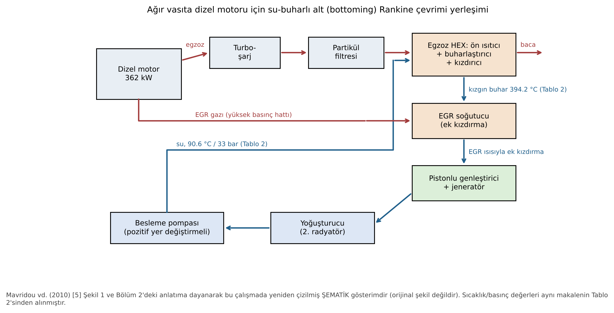

**Şekil 4.** Su-buharlı alt Rankine çevriminin yerleşimi. **[L→Ç]** Mavridou vd. (2010) [5], orijinal Şekil 1 ve Bölüm 2'deki anlatıma dayanarak yeniden çizilmiş şematik gösterim. Sayısal değerler aynı makalenin Tablo 2'sindendir.

**Tasarım noktası [L]:** En yüksek ısı yükü %100 yük ve 1300 rpm'de oluştuğu için ısı değiştirici bu noktaya göre boyutlandırılmıştır. Isı değiştirici üç işlevsel bölgeye ayrılmıştır: ön ısıtıcı, buharlaştırıcı ve kızdırıcı.

**Tablo 4.** Egzoz ısı değiştiricisi tasarım verisi. **[L]** Mavridou vd. (2010) [5], Tablo 2, aynen aktarılmıştır.

| | Ön ısıtıcı | Buharlaştırıcı | Kızdırıcı |
|---|---|---|---|
| Isı yükü [kW] | 31.41 | 85.27 | 19.76 |
| Su-buhar debisi [kg/s] | 0.048 | 0.048 | 0.048 |
| Egzoz debisi [kg/s] | 0.49 | 0.49 | 0.49 |
| Su-buhar basıncı [bar] | 33 | 33 | 33 |
| Egzoz basıncı [bar] | 1 | 1 | 1 |
| Egzoz giriş sıcaklığı T_h,1 [°C] | 318.02 | 469.2 | 503.5 |
| Egzoz çıkış sıcaklığı T_h,2 [°C] | 261.2 | 318.02 | 469.2 |
| Su-buhar giriş sıcaklığı T_c,1 [°C] | 90.56 | 239.2 | 239.2 |
| Su-buhar çıkış sıcaklığı T_c,2 [°C] | 239.2 | 239.2 | 394.2 |

**Tablo 5.** Gövde-boru ısı değiştiricisi parametreleri ve dikdörtgen plaka-kanat yüzey özellikleri. **[L]** Mavridou vd. (2010) [5], Tablo 3 ve Tablo 5.

| Parametre | Değer |
|---|---|
| Perde (baffle) kesimi | %20 |
| Perde sayısı N_b | 2 |
| Boru iç/dış çapı | 12 / 16 mm |
| Azami gövde çapı | 0.49 m |
| Plaka-kanat: kanat aralığı | 404 kanat/m |
| Plaka aralığı P_p | 0.01382 m |
| Kanat kalınlığı t_f | 0.000254 m |
| Plakalar arasında birim hacim başına ısı transfer alanı β | 951.1 m²/m³ |
| Kanat alanı / toplam alan | 0.863 |

**Hesap yöntemi [L]:** Mavridou vd. [5] gövde-boru ısı değiştiricilerini Bell–Delaware yöntemiyle boyutlandırmıştır. Kanat verimi Schmidt yöntemiyle, plaka-kanat tasarımı Kays ve London verileriyle hesaplanmıştır. Boru içi buharlaşma ısı taşınım katsayısı Shah yöntemiyle, ısıl güç LMTD yöntemiyle bulunmuştur. Pompalama gücü, basınç kaybı ile hacimsel debinin çarpımıdır.

### 4.3 Matematiksel model

#### 4.3.1 Isı değiştirici (Mavridou vd. [5], Denklem 1–3) [L]

$$\dot Q = h_{tot}\,A_{heat,tot}\,F\,\mathrm{LMTD} \tag{1}$$

$$\mathrm{LMTD}=\frac{(T_{h,2}-T_{c,1})-(T_{h,1}-T_{c,2})}{\ln\dfrac{T_{h,2}-T_{c,1}}{T_{h,1}-T_{c,2}}} \tag{2}$$

$$h_{tot,st}=\left[\frac{1}{h_s}+R_{f,s}+\frac{t_w}{\lambda_w}\frac{2d_{t,o}}{d_{t,o}+d_{t,i}}+\left(R_{f,t}+\frac{1}{h_t}\right)\frac{d_{t,o}}{d_{t,i}}\right]^{-1} \tag{3}$$

Pompalama gücü: $\dot W_{pompa}=\Delta P\cdot \dot V$.

#### 4.3.2 Rankine/ORC çevrimi (bu çalışmada kullanılan genel model) [H]

Durumlar şöyle tanımlanır: 1 pompa girişi (doymuş sıvı), 2 pompa çıkışı, 3 genleştirici girişi, 4 genleştirici çıkışı.

$$\dot W_p=\dot m\,(h_2-h_1),\qquad h_2=h_1+\frac{h_{2s}-h_1}{\eta_p} \tag{4}$$

$$\dot W_t=\dot m\,(h_3-h_4),\qquad h_4=h_3-\eta_t\,(h_3-h_{4s}) \tag{5}$$

$$\dot Q_{in}=\dot m\,(h_3-h_2)=\dot m_g\,c_{p,g}\,(T_{g,in}-T_{g,out}),\qquad \eta_{th}=\frac{\dot W_t-\dot W_p}{\dot Q_{in}} \tag{6}$$

Akışkan debisi iki kısıttan küçük olanı ile belirlenir:

$$\dot m=\min\left\{\frac{\dot m_g c_{p,g}(T_{g,in}-T_{g,min})}{h_3-h_2},\;\frac{\dot m_g c_{p,g}\,[T_{g,in}-(T_{buh}+\Delta T_{pinch})]}{h_3-h_{f}(P_{yüksek})}\right\} \tag{7}$$

Birinci kısıt egzozun belirli bir sıcaklığın altına soğutulmamasını, ikinci kısıt buharlaşmanın başladığı noktada pinch sıcaklık farkının korunmasını sağlar.

#### 4.3.3 Ekserji analizi [H]

Egzoz için mükemmel gaz ve sabit c_p kabulüyle termal akış ekserjisi:

$$\dot{E}x_g=\dot m_g c_{p,g}\left[(T_{in}-T_{out})-T_0\ln\frac{T_{in}}{T_{out}}\right] \tag{8}$$

Bileşen ekserji yıkımı Gouy–Stodola bağıntısıyla hesaplanır:

$$\dot I=T_0\,\dot S_{gen} \tag{9}$$

$$\dot I_p=\dot m T_0(s_2-s_1),\quad \dot I_t=\dot m T_0(s_4-s_3),\quad \dot I_{HEX}=\dot{E}x_{g,HEX}-\dot m[(h_3-h_2)-T_0(s_3-s_2)] \tag{10}$$

İkinci yasa (ekserji) verimi, net gücün egzozun ölü hale göre toplam termal ekserjisine oranıdır:

$$\eta_{II}=\frac{\dot W_{net}}{\dot{E}x_g(T_{g,in}\to T_0)} \tag{11}$$

#### 4.3.4 TEG modeli [H]

Ioffe bağıntısı modül dönüşüm verimini sıcak ve soğuk yüzey sıcaklıkları ile boyutsuz başarım katsayısına (ZT) bağlar:

$$\eta_{TEG}=\frac{T_h-T_c}{T_h}\cdot\frac{\sqrt{1+ZT}-1}{\sqrt{1+ZT}+T_c/T_h} \tag{12}$$

Burada $ZT=\alpha^2\sigma T/k$ şeklinde tanımlanır. Modül gücü $P=(\alpha\Delta T)^2R_L/(R_i+R_L)^2$ olup azami güç $R_L=R_i$ yük eşleşmesinde elde edilir. MPPT ile bu çalışma noktasının izlenmesi [46]'te gösterilmiştir.

#### 4.3.5 Güç türbini (turbo-kompaund) [H]

$$\dot W_{PT}=\dot m_g c_{p,g}T_{in}\,\eta_{PT}\left[1-PR^{-(\gamma-1)/\gamma}\right] \tag{13}$$

### 4.4 Tasarım parametreleri ve başlangıç koşulları

**Tablo 6.** Bu çalışmanın hesaplarında kullanılan girdi ve varsayımlar **[H]**. Değerlerin kaynağı son sütunda belirtilmiştir.

| Parametre | Değer | Kaynak / gerekçe |
|---|---|---|
| Egzoz giriş sıcaklığı | 503.5 °C | [5] Tablo 1 (%100 yük, 1300 rpm) |
| Egzoz debisi | 0.49 kg/s | [5] Tablo 1 |
| Egzoz c_p | 1.152 kJ/kg·K | [5] Tablo 2'deki üç bölgeden türetilen ortalama (Tablo 7) |
| Genleştirici izentropik verimi | 0.70 | Ricardo–Volvo ve Bosch genleştiricilerinin değeri [6] Tablo 3 |
| Pompa izentropik verimi | 0.60 | Varsayım (küçük debili pozitif yer değiştirmeli pompa) |
| Yoğuşma sıcaklığı | 50 °C (temel) ve 90 °C (duyarlılık) | Varsayım. 90 °C, motor soğutma paketiyle ortak radyatör kullanımına daha yakındır. |
| Egzoz tarafı pinch | 30 K | Varsayım (gaz–sıvı ısı değiştiricisi için tipik) |
| Egzoz çıkışı alt sınırı | 120 °C | Varsayım (asit yoğuşması ve ters basınç sınırı) |
| Buharlaşma sıcaklığı / kızdırma | R245fa 140 °C / 10 K; etanol 200 °C / 20 K; toluen 250 °C / 10 K; su 33 bar (239.2 °C) / 394.2 °C | Su değerleri [5] Tablo 2. Organik akışkanlar kritik sıcaklığın altında, kararlı bölgede seçilmiştir. |
| Ölü hal | 25 °C, 1.013 bar | Standart |

---

## 5. SONUÇLAR VE TARTIŞMA

### 5.1 Mavridou vd. tasarım verisinin bağımsız doğrulaması [H]

Tablo 4'teki verilerle LMTD, gereken UA değeri ve egzozun örtük özgül ısısı hesaplanmıştır. Ayrıca su-buhar tarafının enerji dengesi IAPWS-95 hal denklemleriyle (CoolProp) bağımsız olarak kurulmuştur.

**Tablo 7.** Mavridou vd. [5] Tablo 2 verisinin bağımsız kontrolü. **[H]** Bu çalışmada hesaplanmıştır. Son sütundaki karşılaştırma değerleri [5] Tablo 6a'dan **[L]** alınmıştır.

| Bölge | LMTD [K] | Gereken UA = Q/LMTD [kW/K] | Egzoz c_p (örtük) [kJ/kg·K] | Su tarafı Q, IAPWS-95 [kW] | [5] Tablo 6a: h·A (düz boru) [kW/K] |
|---|---|---|---|---|---|
| Ön ısıtıcı | 118.88 | 0.264 | 1.128 | 31.29 | 79.48·3.68 = 0.292 |
| Buharlaştırıcı | 141.17 | 0.604 | 1.151 | 84.93 | 84.15·7.18 = 0.604 |
| Kızdırıcı | 162.23 | 0.122 | 1.176 | 19.69 | 16.72·7.38 = 0.123 |
| **Toplam** | | | | **135.90** (Mavridou: 136.44) | |

**Yorum [H].**

- Su tarafındaki toplam ısı, IAPWS-95 ile 135.90 kW bulunmuştur. Bu değer Mavridou'nun 136.44 kW değerinden yalnızca %0.4 farklıdır. Fark, buhar tablosu sürümlerinin farklı olmasından kaynaklanabilir.
- Buharlaştırıcı ve kızdırıcıda, Mavridou'nun Tablo 6a'daki h ve A değerlerinin çarpımı, bu çalışmada bağımsız olarak hesaplanan UA ile neredeyse birebir örtüşür (0.604 ile 0.604; 0.123 ile 0.122). Bu bölgelerde Denklem (1)'deki düzeltme faktörü F≈1'dir.
- Ön ısıtıcıda h·A değeri gereken UA'dan yaklaşık %10 büyüktür (0.292 ile 0.264). Bu, 4 geçişli ön ısıtıcıda F≈0.90 alındığı izlenimini verir. Çok geçişli çapraz akışta beklenen bir değerdir.
- Egzozun örtük c_p değeri sıcaklıkla artar (1.128 → 1.176 kJ/kg·K). Bu eğilim yanma ürünlerinin bilinen davranışıyla tutarlıdır.

Şekil 5 aynı veriyi T–Q diyagramı olarak gösterir. Buharlaştırıcı girişinde egzoz ile su arasındaki en küçük sıcaklık farkı (pinch) 318.02 − 239.2 = 78.8 K'dir. Bu kadar büyük bir pinch, egzozun 261 °C'de atıldığı, yani geri kazanılabilir ısının önemli bir kısmının kullanılmadığı anlamına gelir. Su için sabit sıcaklıkta buharlaşma, kaynağa uyumu (temperature glide) sınırlar.

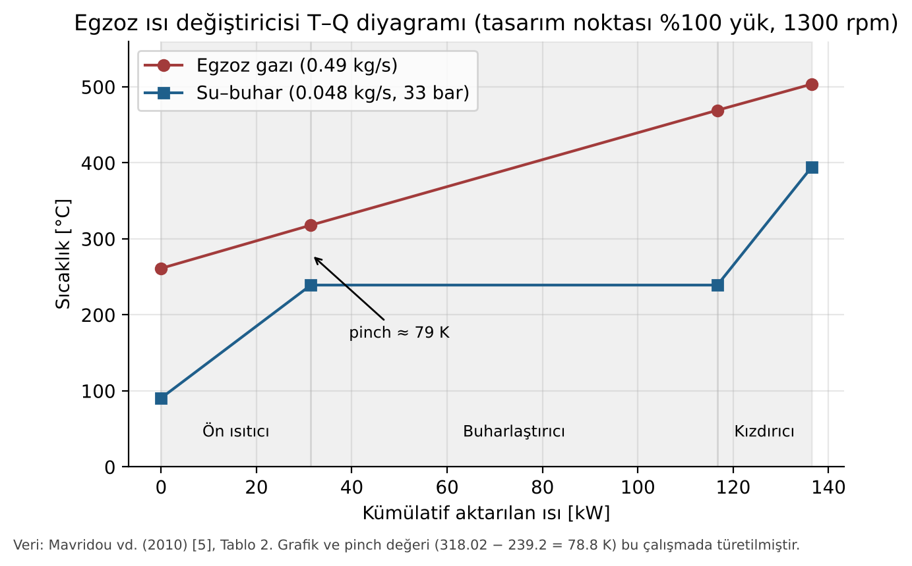

**Şekil 5.** Egzoz ısı değiştiricisinin T–Q diyagramı. **[L→Ç]** Veri: Mavridou vd. (2010) [5], Tablo 2. Pinch değeri bu çalışmada türetilmiştir.

### 5.2 Isı değiştirici tasarımlarının karşılaştırılması [L]

Mavridou vd. [5] aynı ısı yükü (136.44 kW) için yedi tasarım varyantını karşılaştırmıştır. Tablo 8 ve Şekil 6 sonuçları özetler. Makaledeki orijinal Şekil 8–11 bu verilere dayanır.

**Tablo 8.** Isı değiştirici tasarımlarının karşılaştırılması. **[L]** Mavridou vd. (2010) [5], Tablo 6a ve 6b. Referans (m₀, Δp₀, W₀) düz borulu gövde-boru ısı değiştiricisidir.

| Tasarım | V_tot [m³] | m/m₀ | Δp/Δp₀ | W/W₀ | Toplam ısı transfer alanı [m²] |
|---|---|---|---|---|---|
| Gövde-boru, düz boru (342 boru) | 0.200 | 1.00 | 1.00 | 1.00 | 18.24 |
| Gövde-boru, sığ çukurcuklu | 0.176 | 0.88 | 0.8–1.1 | 0.8–1.1 | 15.99 |
| Gövde-boru, derin çukurcuklu | 0.178 | 0.89 | 0.8–1.1 | 0.8–1.1 | 16.18 |
| Gövde-boru, kanatlı boru | 0.217 | 0.49 | 0.553 | 0.59 | 40.73 |
| Plaka-kanat, düz kanat (46 plaka) | 0.0726 | 0.59 | 0.014 | 0.0136 | 67.60 |
| Plaka-kanat, 10 ppi metal köpük | 0.0775 | 0.41 | 0.161 | 0.16 | 71.39 (köpük) |
| Plaka-kanat, 40 ppi metal köpük | 0.0448 | 0.27 | 0.317 | 0.318 | 165.08 (köpük) |

Alan toplamları bu çalışmada Tablo 6a ve 6b'deki bölge değerlerinin toplanmasıyla bulunmuştur **[H]**. 40 ppi köpük için toplam 165.08 m² değeri makalenin metniyle birebir aynıdır.

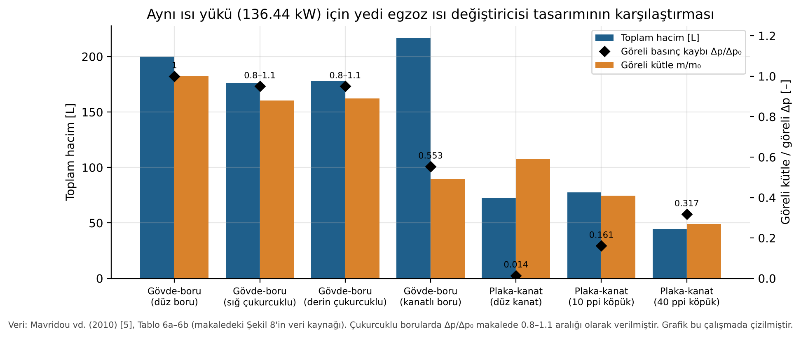

**Şekil 6.** Aynı ısı yükü için yedi egzoz ısı değiştiricisi tasarımının hacmi, göreli kütlesi ve göreli basınç kaybı. **[L→Ç]** Veri: Mavridou vd. (2010) [5], Tablo 6a ve 6b. Grafik bu çalışmada çizilmiştir.

Makalede aktarılan sonuçlar **[L]** [5]:

- Kanatlı borular, düz borulu tasarıma göre kütleyi yaklaşık %51, basınç kaybını yaklaşık %45 azaltır. Buna karşılık kanatlar için boru aralığı büyütüldüğünden hacim %8 artar.
- Standart plaka-kanat tasarımı, kanatlı gövde-boruya göre hacimde yaklaşık %66.5 avantaj sağlar, fakat kütlesi %20.6 fazladır. Basınç kaybı ise belirgin şekilde düşüktür. Plaka tipi tasarımların hepsinde ön yüz alanı yaklaşık 0.6×0.6 m'de sabit tutulmuş, derinlik 2.5–10.3 cm arasında değiştirilmiştir.
- 40 ppi köpüklü tasarım düz borulu gövde-boruya göre %68 daha az pompalama gücü gerektirir ve %73 daha hafiftir. Birim hacim başına aktarılan ısı dört kat fazladır ve toplam hacmi yaklaşık 45 L'dir. Bu boyut motor kaputu altına sığabilecek bir tasarım olarak değerlendirilmiştir.
- Yazarlar belirsizliklere de dikkat çeker: Bell–Delaware yöntemi gövde tarafı ısı taşınım katsayısını ölçülen değerlerin %50–100'ü aralığında tahmin eder; çukurcuklu borularda Nusselt oranı belirsizliği ±%12.6, metal köpükte ısı taşınım katsayısı belirsizliği %30'un altındadır.

**Mühendislik değerlendirmesi [H].** Araç uygulamasında en kritik üç ölçüt hacim, kütle ve ters basınçtır. Bu ölçütler birbiriyle çelişir:

- Ters basınç ve dolayısıyla motorun pompalama kaybı öncelikliyse düz kanatlı plaka-kanat tasarımı en iyisidir (Δp/Δp₀ = 0.014).
- Paketleme öncelikliyse 40 ppi metal köpük en iyisidir.

Düz kanatlı tasarımın kütlesi 40 ppi köpüklü tasarımın 2.2 katı (0.59/0.27), ters basıncı ise yaklaşık 1/23'üdür (0.014/0.317). Turbo şarjlı bir dizel motorda egzoz karşı basıncındaki birkaç kPa'lık artış bile BSFC'yi etkiler. Kim vd. [13] tek bir TEG için 0.45–1.46 kPa ölçmüştür. Bu nedenle uzun yol kamyonu için düz kanatlı plaka-kanat tasarımı daha dengeli bir seçenek olarak öne çıkar. Metal köpüklerin kurumla tıkanma riski de bu tercihi destekler [5].

### 5.3 ORC/Rankine çevrimlerinin enerji ve ekserji analizi [H]

Aynı egzoz kaynağı (503.5 °C, 0.49 kg/s; egzozun 25 °C'ye göre termal ekserjisi 108.9 kW) için dört basit (rejeneratörsüz) çevrim hesaplanmıştır.

**Tablo 9.** Basit Rankine/ORC çevrimlerinin enerji ve ekserji sonuçları. **[H]** Bu çalışmada hesaplanmıştır; literatür sonucu değildir. Varsayımlar Tablo 6'dadır.

| | R245fa | Etanol | Toluen | Su |
|---|---|---|---|---|
| P_yüksek / P_düşük [bar] | 28.37 / 3.44 | 29.81 / 0.294 | 16.72 / 0.123 | 33.0 / 0.124 |
| Akışkan debisi [kg/s] | 0.905 | 0.197 | 0.314 | 0.0607 |
| Genleştirici giriş/çıkış sıcaklığı [°C] | 150 / 88.0 | 220 / 56.6 | 260 / 161.4 | 394.2 / 50 (x₄=0.962) |
| Q_in [kW] | 216.4 | 216.4 | 216.4 | 181.9 |
| Egzoz çıkış sıcaklığı [°C] | 120.0 | 120.0 | 120.0 | 181.2 |
| W_türbin / W_pompa [kW] | 25.69 / 2.96 | 39.84 / 1.27 | 42.00 / 1.03 | 43.17 / 0.34 |
| **W_net [kW]** | **22.73** | **38.57** | **40.96** | **42.83** |
| η_th [%] | 10.5 | 17.8 | 18.9 | 23.6 |
| η_II, egzoz toplam ekserjisine göre [%] | 20.9 | 35.4 | 37.6 | 39.3 |
| İ_HEX [kW] | 52.1 | 33.3 | 27.2 | 20.9 |
| İ_genleştirici [kW] | 9.24 | 15.73 | 12.89 | 17.07 |
| İ_pompa [kW] | 1.09 | 0.47 | 0.38 | 0.12 |
| İ_yoğuşturucu (atılan ekserji) [kW] | 16.73 | 13.78 | 20.41 | 10.76 |
| Bacadan atılan egzoz ekserjisi [kW] | 7.07 | 7.07 | 7.07 | 17.26 |
| **W_net, T_kond = 90 °C [kW] (η_th)** | 12.68 (%5.9) | 28.48 (%13.2) | 32.25 (%14.9) | 32.80 (%19.1) |

**Ekserji dengesi kontrolü (R245fa).** Egzozun toplam ekserjisi 108.94 kW'tır. Çıktıların toplamı: 22.73 (net güç) + 52.09 (HEX) + 9.24 (genleştirici) + 1.09 (pompa) + 16.73 (yoğuşturucu) + 7.07 (baca) = 108.95 kW. Denge kapanmaktadır.

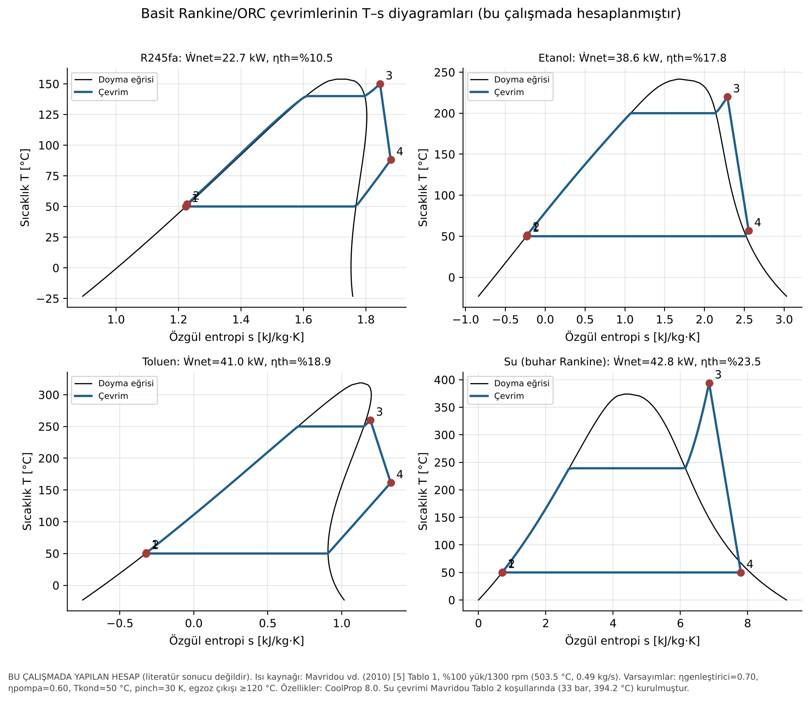

**Şekil 7.** Dört akışkan için T–s diyagramları. **[H]** Bu çalışmada CoolProp ile hesaplanmıştır. 3→4 genleşmesi düz çizgiyle gösterilmiştir.

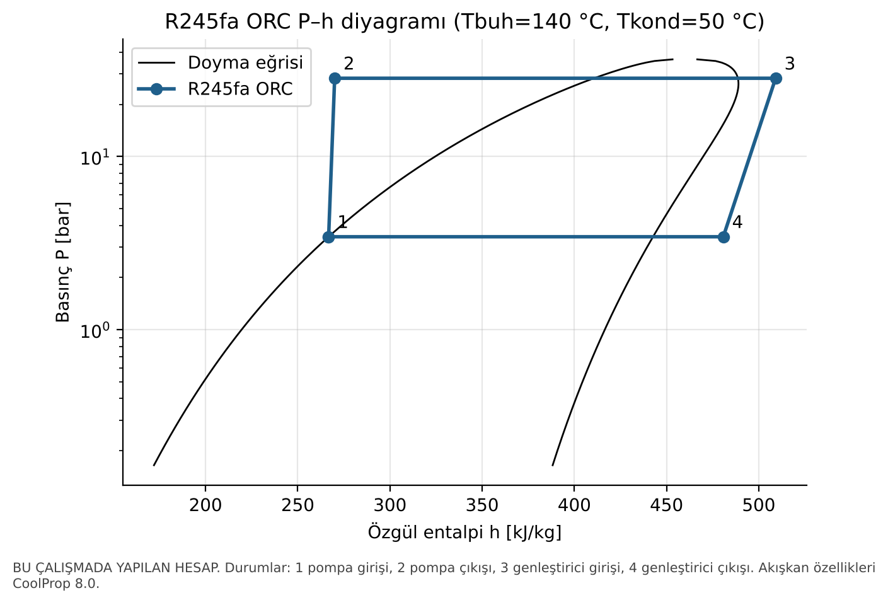

**Şekil 8.** R245fa ORC'nin P–h diyagramı. **[H]**

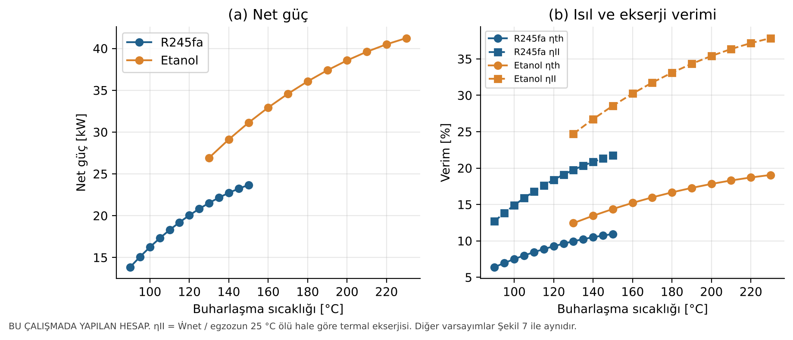

**Şekil 9.** Buharlaşma sıcaklığının net güç, ısıl verim ve ekserji verimine etkisi. **[H]**

**Tartışma.**

1. **Isı değiştirici tersinmezliği baskındır.** R245fa çevriminde ısı değiştiricideki ekserji yıkımı (52.1 kW), egzoz ekserjisinin %48'ine eşittir. Bunun nedeni 500 °C'lik egzozdan ısının 140 °C'de buharlaşan bir akışkana aktarılmasıdır. Buharlaşma sıcaklığı yükseldikçe bu yıkım azalır (Şekil 9) ve sıralama R245fa < etanol < toluen < su olur. Bu sonuç Teng vd. [21]'nin süperkritik ORC önerisinin ve Yağlı vd. [22]'nin süperkritik çevrimde bulduğu küçük üstünlüğün termodinamik gerekçesidir. Kaynak ile akışkan arasındaki sıcaklık uyumunun iyileşmesi, ısı değiştiricideki yıkımı azaltır.
2. **R245fa yüksek sıcaklıklı egzoz için uygun değildir.** Kritik sıcaklığının düşük olması (154 °C) buharlaşma sıcaklığını sınırlar. Genleştirici çıkışı 88 °C kızgın buhardır; bu yüzden rejeneratör kullanılmazsa önemli miktarda ekserji yoğuşturucuda kaybolur (16.7 kW). R245fa ile egzozda %20.9 ekserji verimi bulunmuştur. Yu vd. [10] aynı akışkanla dizel motorda %21.7'ye kadar ekserji verimi bildirmiştir. Değerler benzerdir, ancak çalışma koşulları ve ekserji verimi tanımları farklı olduğundan bu benzerlik birebir doğrulama sayılmamalıdır.
3. **Su çevrimi ideal koşullarda en yüksek gücü verir, fakat pratik sınırları vardır.** Yoğuşturucu basıncı 50 °C'de 0.12 bar'dır; araçta vakum sızdırmazlığı gerekir. Genleştirici çıkışında kuruluk x₄ = 0.962 olduğundan ıslak genleşme oluşur. Hacimsel debi düşük olduğundan pistonlu genleştirici gerekir [5]. Ayrıca kışın donma riski vardır. Mavridou vd. [5] aynı motor ve su koşulları için %6–10 verim kazancı öngörür. Bu çalışmada bulunan 42.8 kW, 362 kW'lık anma gücünün yaklaşık %11.8'idir; ancak bu hesap ideal bileşen kabulüne dayandığı için üst sınır niteliğindedir. Ayrıca 1300 rpm'deki %100 yük gücü yayında verilmediği için oran yalnızca yaklaşık bir karşılaştırma sağlar.
4. **Yoğuşma sıcaklığının etkisi büyüktür.** Yoğuşma sıcaklığı 50 °C'den 90 °C'ye çıkarıldığında R245fa'nın net gücü %44, etanolünki %26, suyunki %23 azalır. Araçta yoğuşturucu ya motor radyatörüyle ortak çalışır ya da ikinci bir radyatör gerektirir [5]. Bu nedenle yoğuşma sıcaklığı, laboratuvar deneylerindeki değerlerden yüksek olur. Simülasyon–deney farkının [12] bir nedeni budur.
5. **Hesapların literatürle uyumu.** Bu çalışmanın hesapları 12.7–42.8 kW aralığında net güç vermiştir. Deneysel genleştirici güçleri ise 1.2–42 kW aralığındadır (Tablo 2) ve Ricardo–Volvo uygulamasında 288 kW'lık motor için 14 kW'tır. Xu vd. [12] simülasyonlarda 0–60 kW, deneylerde 0–14 kW bildirir. Bu çalışmanın sonuçları simülasyon aralığının ortasında, deney değerlerinin üzerinde kalır. Bu durum, ideal genleştirici ve pompa verimi, ihmal edilen ısı kayıpları ve sürekli rejim kabulü ile tutarlıdır. Galindo vd. [35]'nin deneyinde ideal ile gerçek Rankine verimi arasında üç kattan büyük fark bulunması (%19'a karşı %6) bu yorumu destekler.

### 5.4 Literatürde raporlanan kazanımların karşılaştırılması

Şekil 10, farklı çalışmalarda raporlanan kazanımları ölçüt türüne göre iki panelde gösterir. Sol panel yakıt tüketimindeki veya BSFC'deki iyileşmeyi, sağ panel güç ya da verimdeki artışı gösterir.

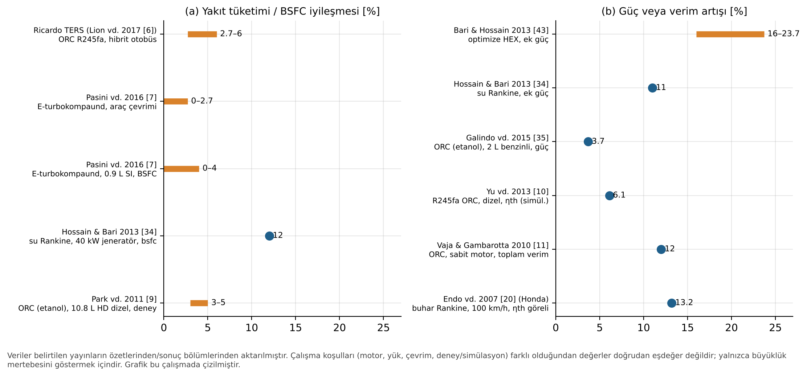

**Şekil 10.** Literatürde raporlanan atık ısı geri kazanım kazanımları. **[L→Ç]** Değerler belirtilen yayınlardan aktarılmıştır. Çalışma koşulları farklı olduğu için değerler doğrudan eşdeğer değildir.

**Karşılaştırmada dikkat edilmesi gerekenler [H].**

- **Ölçüt tanımları farklıdır.** "Yakıt tasarrufu" bir sürüş çevrimi boyunca, "bsfc iyileşmesi" tek bir çalışma noktasında, "ek güç" ise motor gücüne göre ölçülür. Örneğin Hossain ve Bari'nin [34] %11 ek gücü ile %12 bsfc iyileşmesi aynı testin iki farklı ifadesidir. Bu iki değer başka bir çalışmanın %3–5 yakıt tasarrufuyla [9] aynı ölçekte karşılaştırılamaz.
- **Deney ile simülasyon aynı ölçekte değildir.** Yu vd. [10] ile Vaja ve Gambarotta [11] simülasyon sonuçlarıdır; Park vd. [9], Galindo vd. [35] ve Ricardo TERS [6] deney sonuçlarıdır. Deneysel kazanımlar sistematik olarak daha düşüktür [12].
- **Motor türü ve kullanım profili farklıdır.** Sabit motorlar (kojenerasyon [22], jeneratör [34]) sürekli yüksek yükte çalıştığı için araç motorlarından daha yüksek kazanç gösterir. Ricardo TERS'te kazancın %6'dan %2.7'ye düşmesi bu etkiyi açıkça gösterir: hibrit otobüste içten yanmalı motor sürenin yalnızca %45'inde çalışmaktadır [6].

### 5.5 Çelişen sonuçlar ve nedenleri

**Tablo 10.** Literatürdeki çelişkili görünen sonuçlar ve olası nedenleri. **[H]** Bu çalışmanın değerlendirmesidir; dayandığı bulgular **[L]** olarak belirtilen kaynaklardan alınmıştır.

| Konu | Bulgu A | Bulgu B | Olası neden |
|---|---|---|---|
| Akışkanın ısı değiştiriciye etkisi | Organik akışkanlarda ısı değiştirici etkenliği sudan yüksektir [39] | Organik akışkan kullanımı ısı değiştirici boyutlandırmasını önemli ölçüde değiştirmez [5] | [39] etkenliği (ε) sabit kaynak koşulunda karşılaştırır; organik akışkanın sıcaklık profili egzoza daha iyi uyar. [5] ise sabit ısı yükü için gereken alanı karşılaştırır. Alan büyük ölçüde gaz tarafı direnci tarafından belirlenir ve bu direnç akışkandan bağımsızdır. İki çalışma farklı soruları yanıtlamaktadır. |
| Turbo-kompaundun faydası | Turbo-kompaund yakıt tüketimini azaltmak için umut verici bir yoldur [32] | Sabit noktada kazanç ≈%1'dir; yüksek devirde negatiftir; küçük araçta fayda yoktur [7] | Kazanç türbin verimine, türbin boyutuna ve motor yükünün dağılımına bağlıdır. Yüksek yükte uzun süre çalışan ağır vasıtada fayda belirgindir; küçük benzinli motorda ters basınç cezası kazancı dengeler. |
| Rankine mi turbo-kompaund mu? | Egzoz ısısıyla çalışan ikincil buhar çevrimi daha avantajlıdır [48] | Turbo-kompaund daha basit, ucuz ve kompakttır [32] | Biri termodinamik verimi, diğeri maliyet ve paketlemeyi ölçüt alır. İki yaklaşım birlikte de kullanılabilir. |
| Deneysel ve sayısal güç | Simülasyonlarda 0–60 kW | Deneylerde 0–14 kW [12] | İyimser genleştirici ve pompa verimleri, ihmal edilen ısı kayıpları, çok kaynaklı ısı girişi kabulleri ve yoğuşma sıcaklığı farkları [12]. Bu çalışmanın Tablo 9'u da aynı eğilimi gösterir. |
| TEG çıkış gücü | Yaklaşık 0.1 kW, %2.8 [13] | Yaklaşık 0.94 kW [14] | Modül sayısı, egzoz debisi ve sıcaklığı, soğutma yöntemi ve araç sınıfı farklıdır. Bu nedenle mutlak güç değil, dönüşüm verimi ve ters basınç karşılaştırılmalıdır. |

### 5.6 TEG ve turbo-kompaund için tamamlayıcı hesaplar [H]

**TEG.** Ioffe bağıntısına (Denklem 12) göre ZT = 1 olan bir malzeme için modül verimi %7.8 bulunmuştur (T_h = 250 °C, T_c = 50 °C). Kim vd. [13]'nin ölçtüğü %2.8 bu değerin yaklaşık üçte biridir (Şekil 11). Aradaki farkın olası nedenleri şunlardır: egzoz–modül ve modül–soğutucu arasındaki ısıl direnç nedeniyle modül yüzeylerindeki sıcaklık farkının gaz–su farkından küçük olması, yüzeyde sıcaklığın üniform olmaması [2] ve yük uyumsuzluğu [46]. Kim vd. [13]'nin verilerinden, azami güç noktasında modüllerden geçen ısı akısı yaklaşık 119 W / 0.028 ≈ 4.25 kW olarak türetilir. Bu değer Şekil 2'deki 34–136 kW'lık egzoz ısısının küçük bir bölümüdür. TEG'in güç kapasitesini ısı değiştirici tasarımı sınırlar.

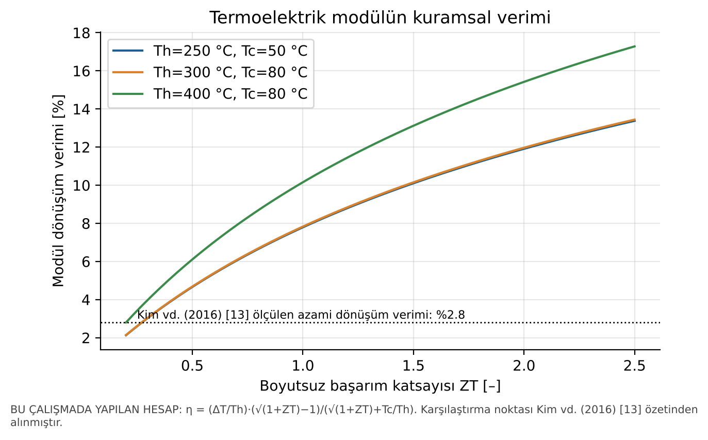

**Şekil 11.** Termoelektrik modülün kuramsal verimi ve ZT'ye bağlılığı. **[H]** Karşılaştırma noktası Kim vd. [13]'den **[L]** alınmıştır.

**Güç türbini.** Mavridou egzozu için (503.5 °C, 0.49 kg/s), %70 türbin verimiyle brüt türbin gücü şöyle bulunmuştur: PR = 1.2 için 13.9 kW, PR = 1.4 için 25.1 kW, PR = 1.6 için 34.5 kW (Şekil 12). Bu değerler brüttür. Türbinin oluşturduğu ters basınç motorun pompalama işini artırır ve Pasini vd. [7]'nin gösterdiği gibi sabit noktada net kazancı ≈%1'e indirebilir. Dolayısıyla Şekil 12 yalnızca üst sınırı gösterir.

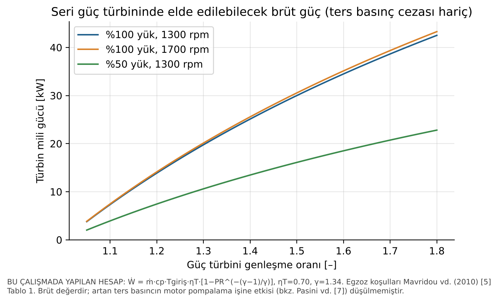

**Şekil 12.** Seri güç türbininden elde edilebilecek brüt güç. **[H]** Egzoz koşulları Mavridou vd. [5] Tablo 1'dendir.

### 5.7 Uygulanabilirlik değerlendirmesi [H]

**Tablo 11.** Teknolojilerin uygulama alanına göre uygunluğu. Bu çalışmanın literatüre dayalı nitel değerlendirmesidir.

| Kriter | ORC | Su-buhar Rankine | TEG | Elektrik turbo-kompaund |
|---|---|---|---|---|
| Ağır vasıta (uzun yol) | Yüksek | Orta | Düşük | Orta-yüksek |
| Binek araç (şehir içi) | Düşük | Düşük | Orta (elektrik ihtiyacı) | Düşük [7] |
| Sabit motor / kojenerasyon | Çok yüksek [22] | Yüksek [34] | Düşük | Orta |
| Gemi | Yüksek [17] | Yüksek [17] | Düşük | Yüksek [17] |
| Teknolojik olgunluk | Prototip ve filo testi [6] | Prototip [20] | Prototip [14] | Ticari (mekanik) [32] |
| Temel risk | Akışkan güvenliği, kontrol | Donma, vakum | Maliyet, verim | Ters basınç |

---

## 6. SONUÇ

### 6.1 Genel değerlendirme

1. **[L]** İYM'lerde yakıt enerjisinin %30–40'ı egzozla atılır [5], [8]. Ağır vasıta dizel motorlarında fren gücüne dönüşen pay en fazla %40–45'tir [6]. Soğutma suyu enerji bakımından büyük, fakat ekserji bakımından küçük bir kaynaktır. ORC'lerle egzoz ısısının yaklaşık %75'i, gömlek suyu ısısının ise yalnızca %9.5'i geri kazanılabilmektedir [10].
2. **[L]** Rankine ve ORC sistemleri deneysel olarak en yüksek kazancı sağlayan teknolojilerdir: %3–6 yakıt tasarrufu [6], [9] ve binek araçta ısıl verimde göreli %13.2 artış [20]. TEG'ler %3 dolayında dönüşüm verimiyle yüzlerce watt düzeyinde güç üretir [13], [14]. Elektrik turbo-kompaundun faydası büyük ölçüde çalışma profiline bağlıdır [7].
3. **[L]** Egzoz ısı değiştiricisinde 40 ppi metal köpük hacim ve kütle bakımından, düz kanatlı plaka-kanat tasarımı ise ters basınç bakımından üstündür [5].
4. **[H]** Bu çalışmanın bağımsız kontrolü Mavridou vd. [5]'nin tasarım verisinin iç tutarlılığını doğrulamıştır: su tarafındaki enerji dengesi %0.4 farkla, buharlaştırıcı ve kızdırıcının UA değerleri ise birebir örtüşmüştür.
5. **[H]** Ekserji analizi, en büyük tersinmezliğin egzoz ısı değiştiricisinde oluştuğunu göstermiştir. R245fa çevriminde bu yıkım egzoz ekserjisinin %48'idir. Yüksek kritik sıcaklıklı akışkanlar (toluen, etanol) veya su, bu kaybı yarıya indirmektedir. 500 °C mertebesindeki egzozda R245fa gibi düşük kritik sıcaklıklı akışkanlar ancak rejeneratörle ya da çift çevrimli yapıda düşük sıcaklık çevrimi olarak anlamlıdır [40], [41].

### 6.2 Geliştirme önerileri

1. **Akışkan ve çevrim yapısı:** Uzun yol kamyonunda egzoz ve EGR için yüksek sıcaklık çevriminde etanol veya etanol-su karışımı [6], soğutma suyu ve şarj havası için düşük sıcaklık çevriminde R245fa veya R1233zd(E) kullanılan çift çevrimli bir yapı incelenmelidir [40].
2. **Isı değiştirici:** Partikül filtresinden sonra konumlandırılmış düz kanatlı plaka-kanat tasarımı [5] temel alınmalıdır. Girdap üreteci gibi düşük basınç kayıplı iyileştirmeler [51] SST k–ω ile doğrulanmış CFD [1] ile değerlendirilmelidir.
3. **Geçici rejim ve kontrol:** Sürekli rejim tasarımının yanında, WHTC/ESC çevrimleri üzerinde evaporatörün dinamik modeli ve motor–ORC entegre kontrolü geliştirilmelidir [12].
4. **Net fayda hesabı:** Ters basınç, ek radyatör fanının gücü ve sistem ağırlığı net kazançtan düşülmelidir. Literatürün önemli bir kısmında bu kalemler eksiktir [5], [7], [12].
5. **Hibrit sistemler:** TEG'in yoğuşturucu öncesine veya ORC'nin bacasına eklenmesi [38] ve elektrik turbo-kompaundun hibrit araçla birlikte kullanılması [7] bütüncül bir sistem optimizasyonuyla değerlendirilmelidir.
6. **Ulusal bağlam:** Türkiye'deki araç parkı ve kojenerasyon motorları için teknik-ekonomik çalışmalar [22]–[25] genişletilmeli, YÖK Tez arşivindeki lisansüstü tezler sistematik olarak taranmalıdır.

### 6.3 Sınırlılıklar

- Elsevier, MDPI ve SAE tam metinlerine erişilemediği için bazı yayınlardan yalnızca özet düzeyinde sonuç aktarılabilmiş, orijinal şekil ve tablo numaraları verilememiştir.
- CFD konturlarının ve deney düzeneği fotoğraflarının görselleri rapora eklenememiştir. Eklenmesi gereken şekiller Ek A'da listelenmiştir.
- Bu çalışmanın hesapları basit çevrim, sabit egzoz c_p ve ideal bileşen kabullerine dayanır. Ters basınç ve ısı kayıpları hesaba katılmamıştır; sonuçlar üst sınır niteliğindedir.

---

## KAYNAKÇA

[1] M. Hatami, D. D. Ganji, and M. Gorji-Bandpy, "Numerical study of finned type heat exchangers for ICEs exhaust waste heat recovery," *Case Studies in Thermal Engineering*, vol. 4, pp. 53–64, 2014, doi: 10.1016/j.csite.2014.07.002.

[2] C. Q. Su, W. S. Wang, X. Liu, and Y. D. Deng, "Simulation and experimental study on thermal optimization of the heat exchanger for automotive exhaust-based thermoelectric generators," *Case Studies in Thermal Engineering*, vol. 4, pp. 85–91, 2014, doi: 10.1016/j.csite.2014.06.002.

[3] B. Orr, A. Akbarzadeh, M. Mochizuki, and R. Singh, "A review of car waste heat recovery systems utilising thermoelectric generators and heat pipes," *Applied Thermal Engineering*, vol. 101, pp. 490–495, 2016, doi: 10.1016/j.applthermaleng.2015.10.081.

[4] S. Quoilin, M. Van Den Broek, S. Declaye, P. Dewallef, and V. Lemort, "Techno-economic survey of Organic Rankine Cycle (ORC) systems," *Renewable and Sustainable Energy Reviews*, vol. 22, pp. 168–186, 2013, doi: 10.1016/j.rser.2013.01.028.

[5] S. Mavridou, G. C. Mavropoulos, D. Bouris, D. T. Hountalas, and G. Bergeles, "Comparative design study of a diesel exhaust gas heat exchanger for truck applications with conventional and state of the art heat transfer enhancements," *Applied Thermal Engineering*, vol. 30, no. 8–9, pp. 935–947, 2010, doi: 10.1016/j.applthermaleng.2010.01.003. [Kabul edilmiş yazar sürümü: https://openaccess.city.ac.uk/id/eprint/14857/]

[6] S. Lion, C. N. Michos, I. Vlaskos, C. Rouaud, and R. Taccani, "A review of waste heat recovery and Organic Rankine Cycles (ORC) in on-off highway vehicle Heavy Duty Diesel Engine applications," *Renewable and Sustainable Energy Reviews*, vol. 79, pp. 691–708, 2017, doi: 10.1016/j.rser.2017.05.082.

[7] G. Pasini, G. Lutzemberger, S. Frigo, S. Marelli, M. Ceraolo, R. Gentili, and M. Capobianco, "Evaluation of an electric turbo compound system for SI engines: A numerical approach," *Applied Energy*, vol. 162, pp. 527–540, 2016, doi: 10.1016/j.apenergy.2015.10.143. [Yazar sürümü: https://arpi.unipi.it/handle/11568/760807]

[8] D. T. Hountalas, C. O. Katsanos, and V. T. Lamaris, "Recovering energy from the diesel engine exhaust using mechanical and electrical turbocompounding," SAE Technical Paper 2007-01-1563, 2007, doi: 10.4271/2007-01-1563.

[9] T. Park, H. Teng, G. L. Hunter, B. van der Velde, and J. Klaver, "A Rankine cycle system for recovering waste heat from HD diesel engines – experimental results," SAE Technical Paper 2011-01-1337, 2011, doi: 10.4271/2011-01-1337.

[10] G. Yu, G. Shu, H. Tian, H. Wei, and L. Liu, "Simulation and thermodynamic analysis of a bottoming Organic Rankine Cycle (ORC) of diesel engine (DE)," *Energy*, vol. 51, pp. 281–290, 2013, doi: 10.1016/j.energy.2012.10.054.

[11] I. Vaja and A. Gambarotta, "Internal Combustion Engine (ICE) bottoming with Organic Rankine Cycles (ORCs)," *Energy*, vol. 35, no. 2, pp. 1084–1093, 2010, doi: 10.1016/j.energy.2009.06.001.

[12] B. Xu, D. Rathod, A. Yebi, Z. Filipi, S. Onori, and M. Hoffman, "A comprehensive review of organic Rankine cycle waste heat recovery systems in heavy-duty diesel engine applications," *Renewable and Sustainable Energy Reviews*, vol. 107, pp. 145–170, 2019, doi: 10.1016/j.rser.2019.03.012.

[13] T. Y. Kim, A. A. Negash, and G. Cho, "Waste heat recovery of a diesel engine using a thermoelectric generator equipped with customized thermoelectric modules," *Energy Conversion and Management*, vol. 124, pp. 280–286, 2016, doi: 10.1016/j.enconman.2016.07.013.

[14] X. Liu, Y. D. Deng, Z. Li, and C. Q. Su, "Performance analysis of a waste heat recovery thermoelectric generation system for automotive application," *Energy Conversion and Management*, vol. 90, pp. 121–127, 2015, doi: 10.1016/j.enconman.2014.11.015.

[15] R. Saidur, M. Rezaei, W. K. Muzammil, M. H. Hassan, S. Paria, and M. Hasanuzzaman, "Technologies to recover exhaust heat from internal combustion engines," *Renewable and Sustainable Energy Reviews*, vol. 16, no. 8, pp. 5649–5659, 2012, doi: 10.1016/j.rser.2012.05.018.

[16] J. B. Heywood, *Internal Combustion Engine Fundamentals*, 2nd ed. New York, NY, USA: McGraw-Hill Education, 2018.

[17] G. Shu, Y. Liang, H. Wei, H. Tian, J. Zhao, and L. Liu, "A review of waste heat recovery on two-stroke IC engine aboard ships," *Renewable and Sustainable Energy Reviews*, vol. 19, pp. 385–401, 2013, doi: 10.1016/j.rser.2012.11.034.

[18] V. Pandiyarajan, M. Chinna Pandian, E. Malan, R. Velraj, and R. V. Seeniraj, "Experimental investigation on heat recovery from diesel engine exhaust using finned shell and tube heat exchanger and thermal storage system," *Applied Energy*, vol. 88, no. 1, pp. 77–87, 2011, doi: 10.1016/j.apenergy.2010.07.023.

[19] J. Fu, J. Liu, R. Feng, Y. Yang, L. Wang, and Y. Wang, "Energy and exergy analysis on gasoline engine based on mapping characteristics experiment," *Applied Energy*, vol. 102, pp. 622–630, 2013, doi: 10.1016/j.apenergy.2012.08.013.

[20] T. Endo, S. Kawajiri, Y. Kojima, K. Takahashi, T. Baba, S. Ibaraki, T. Takahashi, and M. Shinohara, "Study on maximizing exergy in automotive engines," SAE Technical Paper 2007-01-0257, 2007, doi: 10.4271/2007-01-0257.

[21] H. Teng, G. Regner, and C. Cowland, "Waste heat recovery of heavy-duty diesel engines by organic Rankine cycle Part I: Hybrid energy system of diesel and Rankine engines," SAE Technical Paper 2007-01-0537, 2007, doi: 10.4271/2007-01-0537.

[22] H. F. Yağlı, Y. Koç, A. Koç, A. Görgülü, and A. Tandiroğlu, "Parametric optimization and exergetic analysis comparison of subcritical and supercritical organic Rankine cycle (ORC) for biogas fuelled combined heat and power (CHP) engine exhaust gas waste heat," *Energy*, vol. 111, pp. 923–932, 2016, doi: 10.1016/j.energy.2016.05.119.

[23] Y. Koç, H. Yağlı, and A. Koç, "Exergy analysis and performance improvement of a subcritical/supercritical organic Rankine cycle (ORC) for exhaust gas waste heat recovery in a biogas fuelled combined heat and power (CHP) engine through the use of regeneration," *Energies*, vol. 12, no. 4, Art. no. 575, 2019, doi: 10.3390/en12040575.

[24] M. Karabulut, C. Sayın, and S. Erdoğan, "Effects of an exhaust system equipped with a thermoelectric generator on combustion, performance, emissions, and energy recovery in a diesel engine using biodiesel," *Energies*, vol. 17, no. 5, Art. no. 1083, 2024, doi: 10.3390/en17051083.

[25] M. Eyidogan, F. Canka Kilic, D. Kaya, V. Coban, and S. Cagman, "Investigation of Organic Rankine Cycle (ORC) technologies in Turkey from the technical and economic point of view," *Renewable and Sustainable Energy Reviews*, vol. 58, pp. 885–895, 2016, doi: 10.1016/j.rser.2015.12.158.

[26] H. Chen, D. Y. Goswami, and E. K. Stefanakos, "A review of thermodynamic cycles and working fluids for the conversion of low-grade heat," *Renewable and Sustainable Energy Reviews*, vol. 14, no. 9, pp. 3059–3067, 2010, doi: 10.1016/j.rser.2010.07.006.

[27] D. Champier, "Thermoelectric generators: A review of applications," *Energy Conversion and Management*, vol. 140, pp. 167–181, 2017, doi: 10.1016/j.enconman.2017.02.070.

[28] L. E. Bell, "Cooling, heating, generating power, and recovering waste heat with thermoelectric systems," *Science*, vol. 321, no. 5895, pp. 1457–1461, 2008, doi: 10.1126/science.1158899.

[29] G. J. Snyder and E. S. Toberer, "Complex thermoelectric materials," *Nature Materials*, vol. 7, no. 2, pp. 105–114, 2008, doi: 10.1038/nmat2090.

[30] C. Sprouse III and C. Depcik, "Review of organic Rankine cycles for internal combustion engine exhaust waste heat recovery," *Applied Thermal Engineering*, vol. 51, no. 1–2, pp. 711–722, 2013, doi: 10.1016/j.applthermaleng.2012.10.017.

[31] T. Wang, Y. Zhang, Z. Peng, and G. Shu, "A review of researches on thermal exhaust heat recovery with Rankine cycle," *Renewable and Sustainable Energy Reviews*, vol. 15, no. 6, pp. 2862–2871, 2011, doi: 10.1016/j.rser.2011.03.015.

[32] H. Aghaali and H.-E. Ångström, "A review of turbocompounding as a waste heat recovery system for internal combustion engines," *Renewable and Sustainable Energy Reviews*, vol. 49, pp. 813–824, 2015, doi: 10.1016/j.rser.2015.04.144.

[33] M. Hatami, D. D. Ganji, and M. Gorji-Bandpy, "A review of different heat exchangers designs for increasing the diesel exhaust waste heat recovery," *Renewable and Sustainable Energy Reviews*, vol. 37, pp. 168–181, 2014, doi: 10.1016/j.rser.2014.05.004.

[34] S. N. Hossain and S. Bari, "Waste heat recovery from the exhaust of a diesel generator using Rankine Cycle," *Energy Conversion and Management*, vol. 75, pp. 141–151, 2013, doi: 10.1016/j.enconman.2013.06.009.

[35] J. Galindo, S. Ruiz, V. Dolz, L. Royo-Pascual, R. Haller, B. Nicolas, and Y. Glavatskaya, "Experimental and thermodynamic analysis of a bottoming Organic Rankine Cycle (ORC) of gasoline engine using swash-plate expander," *Energy Conversion and Management*, vol. 103, pp. 519–532, 2015, doi: 10.1016/j.enconman.2015.06.085.

[36] E. H. Wang, H. G. Zhang, B. Y. Fan, M. G. Ouyang, Y. Zhao, and Q. H. Mu, "Study of working fluid selection of organic Rankine cycle (ORC) for engine waste heat recovery," *Energy*, vol. 36, no. 5, pp. 3406–3418, 2011, doi: 10.1016/j.energy.2011.03.041.

[37] H. Tian, G. Shu, H. Wei, X. Liang, and L. Liu, "Fluids and parameters optimization for the organic Rankine cycles (ORCs) used in exhaust heat recovery of Internal Combustion Engine (ICE)," *Energy*, vol. 47, no. 1, pp. 125–136, 2012, doi: 10.1016/j.energy.2012.09.021.

[38] G. Shu, J. Zhao, H. Tian, X. Liang, and H. Wei, "Parametric and exergetic analysis of waste heat recovery system based on thermoelectric generator and organic Rankine cycle utilizing R123," *Energy*, vol. 45, no. 1, pp. 806–816, 2012, doi: 10.1016/j.energy.2012.07.010.

[39] A. Domingues, H. Santos, and M. Costa, "Analysis of vehicle exhaust waste heat recovery potential using a Rankine cycle," *Energy*, vol. 49, pp. 71–85, 2013, doi: 10.1016/j.energy.2012.11.001.

[40] H. G. Zhang, E. H. Wang, and B. Y. Fan, "A performance analysis of a novel system of a dual loop bottoming organic Rankine cycle (ORC) with a light-duty diesel engine," *Applied Energy*, vol. 102, pp. 1504–1513, 2013, doi: 10.1016/j.apenergy.2012.09.018.

[41] G. Shu, L. Liu, H. Tian, H. Wei, and G. Yu, "Parametric and working fluid analysis of a dual-loop organic Rankine cycle (DORC) used in engine waste heat recovery," *Applied Energy*, vol. 113, pp. 1188–1198, 2014, doi: 10.1016/j.apenergy.2013.08.027.

[42] V. Dolz, R. Novella, A. García, and J. Sánchez, "HD Diesel engine equipped with a bottoming Rankine cycle as a waste heat recovery system. Part 1: Study and analysis of the waste heat energy," *Applied Thermal Engineering*, vol. 36, pp. 269–278, 2012, doi: 10.1016/j.applthermaleng.2011.10.025.

[43] S. Bari and S. N. Hossain, "Waste heat recovery from a diesel engine using shell and tube heat exchanger," *Applied Thermal Engineering*, vol. 61, no. 2, pp. 355–363, 2013, doi: 10.1016/j.applthermaleng.2013.08.020.

[44] C.-T. Hsu, G.-Y. Huang, H.-S. Chu, B. Yu, and D.-J. Yao, "Experiments and simulations on low-temperature waste heat harvesting system by thermoelectric power generators," *Applied Energy*, vol. 88, no. 4, pp. 1291–1297, 2011, doi: 10.1016/j.apenergy.2010.10.005.

[45] M. A. Karri, E. F. Thacher, and B. T. Helenbrook, "Exhaust energy conversion by thermoelectric generator: Two case studies," *Energy Conversion and Management*, vol. 52, no. 3, pp. 1596–1611, 2011, doi: 10.1016/j.enconman.2010.10.013.

[46] C. Yu and K. T. Chau, "Thermoelectric automotive waste heat energy recovery using maximum power point tracking," *Energy Conversion and Management*, vol. 50, no. 6, pp. 1506–1512, 2009, doi: 10.1016/j.enconman.2009.02.015.

[47] R. Zhao, W. Zhuge, Y. Zhang, Y. Yin, Z. Chen, and Z. Li, "Parametric study of power turbine for diesel engine waste heat recovery," *Applied Thermal Engineering*, vol. 67, no. 1–2, pp. 308–319, 2014, doi: 10.1016/j.applthermaleng.2014.03.032.

[48] W. M. S. R. Weerasinghe, R. K. Stobart, and S. M. Hounsham, "Thermal efficiency improvement in high output diesel engines a comparison of a Rankine cycle with turbo-compounding," *Applied Thermal Engineering*, vol. 30, no. 14–15, pp. 2253–2256, 2010, doi: 10.1016/j.applthermaleng.2010.04.028.

[49] X. Liu, Y. D. Deng, K. Zhang, M. Xu, Y. Xu, and C. Q. Su, "Experiments and simulations on heat exchangers in thermoelectric generator for automotive application," *Applied Thermal Engineering*, vol. 71, no. 1, pp. 364–370, 2014, doi: 10.1016/j.applthermaleng.2014.07.022.

[50] H. Lu, T. Wu, S. Bai, K. Xu, Y. Huang, W. Gao, X. Yin, and L. Chen, "Experiment on thermal uniformity and pressure drop of exhaust heat exchanger for automotive thermoelectric generator," *Energy*, vol. 54, pp. 372–377, 2013, doi: 10.1016/j.energy.2013.02.067.

[51] M. Hatami, D. D. Ganji, and M. Gorji-Bandpy, "Experimental and thermodynamical analyses of the diesel exhaust vortex generator heat exchanger for optimizing its operating condition," *Applied Thermal Engineering*, vol. 75, pp. 580–591, 2015, doi: 10.1016/j.applthermaleng.2014.09.058.

[52] M. Hatami, D. D. Ganji, and M. Gorji-Bandpy, "Experimental and numerical analysis of the optimized finned-tube heat exchanger for OM314 diesel exhaust exergy recovery," *Energy Conversion and Management*, vol. 97, pp. 26–41, 2015, doi: 10.1016/j.enconman.2015.03.032.

---

## EK A — Rapora eklenmesi önerilen orijinal görseller

Aşağıdaki görseller lisans koşulları sağlanarak (CC BY-NC-ND için değiştirmeden, ticari olmayan kullanım ve atıfla) ya da yayıncıdan izin alınarak rapora eklenebilir. Şekil numaraları yalnızca tam metni okunabilen yayınlar için verilmiştir.

| Rapor bölümü | Görsel | Kaynak | Lisans / durum |
|---|---|---|---|
| 3.5, CFD | Kanatlı egzoz ısı değiştiricilerinin CFD sıcaklık ve hız konturları; türbülans modeli karşılaştırması | Hatami vd. 2014 [1] | CC BY-NC-ND; değiştirmeden kullanılabilir (şekil numaraları tam metinden alınmalıdır) |
| 3.5, CFD | TEG ısı değiştiricisi iç yapılarının CFD sıcaklık dağılımları ve kızılötesi görüntüleri | Su vd. 2014 [2] | CC BY-NC-ND |
| 3.3, TEG | TEG ve ısı borusu sistem şemaları | Orr vd. 2016 [3] | CC BY-NC-ND |
| 3.2, ORC | ORC pazar ve genleştirici görselleri | Quoilin vd. 2013 [4] | CC BY-NC-ND |
| 4.2, tasarım | Rankine yerleşimi (orijinal Şekil 1), ısı değiştirici geometrileri (Şekil 2–7), sonuç grafikleri (Şekil 8–11) | Mavridou vd. 2010 [5] | Kabul edilmiş yazar sürümü CC BY-NC-ND 4.0 (City Research Online) |
| 3.2, ORC | ORC yerleşimi ve etanol T–s diyagramı (orijinal Şekil 7), kanatlı borulu egzoz ısı değiştiricisi (Şekil 8), pistonlu genleştirici (Şekil 9) | Lion vd. 2017 [6] | Yazar sonrası sürüm; yayıncı izni gerekir |
| 3.4, turbo-kompaund | Turbo şarj test düzeneği (orijinal Şekil 1), türbin ve kompresör haritaları (Şekil 2–3), AVL BOOST modeli (Şekil 4), BSFC haritası ve karşılaştırmaları (Şekil 5–8) | Pasini vd. 2016 [7] | Yazar sürümü; yayıncı izni gerekir |
| 3.2, deney | Deney düzeneği ve eğik plakalı genleştirici | Galindo vd. 2015 [35] | Yazar sürümü (RiuNet); yayıncı izni gerekir |

## EK B — Hesapların tekrar üretilmesi

```bash
pip install CoolProp matplotlib numpy
```

```bash
cd Atik_Isi_Geri_Kazanim/hesap && python3 hesaplar.py
```

Tüm sayısal çıktılar `hesap/sonuclar.json` dosyasına, şekiller `sekiller/` klasörüne yazılır.
